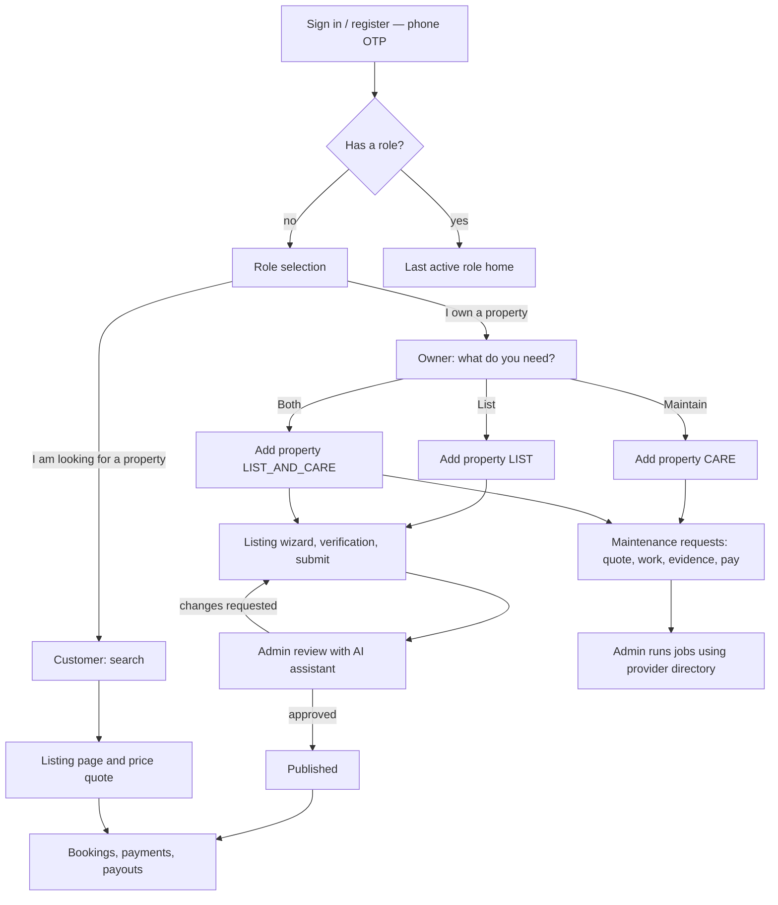

# Gharsetu — Development Specification

**Edition:** Claude Code implementation spec
**Version:** 0.3 (adds rental listings, the Owner / Customer / Admin role model and an AI layer to v0.2)
**Last updated:** 20 October 2026
**Status:** Ready for implementation planning. Open business policies are isolated as configuration (see §19).
**Market:** India only at launch (INR, IST, Indian mobile numbers)
**Working name:** **Gharsetu** — *ghar* (home) + *setu* (bridge): the bridge between a property, its owner, and the people who stay in it or look after it. This is a working name only; verify trademark, domain and social handles before launch (§19).
**Suggested location in repo:** `docs/SPEC.md`

> **Reading tip.** The Operator is the business that runs {{brand}}. "Admin" is a staff user of the Operator. "Owner" is a real-estate owner. "Customer" is a person looking for a property to stay in. "Provider" is a worker or a group that performs maintenance work; providers are directory records managed by admins (they do not log in at the MVP stage).

---

## Contents

0 Instructions for Claude Code · 1 Product summary · 2 Roles · 3 Entry flow and onboarding · 4 Scope · 5 Locked technical decisions · 6 Domain model and state machines · 7 Business rules · 8 Module specifications · 9 Service catalogue and intake configuration · 10 Policy configuration · 11 Data model · 12 API · 13 Permissions matrix · 14 Non-functional requirements · 15 UI requirements · 16 Notifications · 17 Milestones · 18 Testing · 19 Business-pending items · 20 Definition of done · Appendices A–D

---

## 0. Instructions for Claude Code

### 0.1 How to read this document

- **MUST / MUST NOT / SHOULD** are used in the RFC 2119 sense.
- **Decision** — settled for implementation. Do not re-litigate or ask.
- **Policy default** — a business rule with a sensible seed value. Implement it as database-backed configuration (`policy_settings`, §10) and seed the default. Never hard-code it.
- **Business-pending** — an external choice not yet made (payment provider, SMS vendor, tax/invoice layout, legal text, competitor fee verification). Build it behind an adapter or configuration with a mock/stub and leave a clearly marked extension point.
- Where this spec is silent, pick the simplest option consistent with the rest of the document and record it in `docs/DECISIONS.md` (one line: date, decision, reason). Ask the user only if a wrong guess would be expensive to reverse (data model, security, money).
- This is an engineering spec, not legal or accounting advice. Do not write legal text, tax rules or policy wording as if final; use clearly marked placeholder text.

### 0.2 Brand rule

- The product name is configuration, not code. Provide one `brand` config module fed by environment variables: `PRODUCT_NAME` (default `Gharsetu`), `LEGAL_ENTITY_NAME`, `SUPPORT_EMAIL`, `SUPPORT_PHONE`. Variables the web app needs are exposed with the `NEXT_PUBLIC_` prefix.
- MUST NOT hard-code the product name, a domain or a logo in source, copy, tests, package names, database names or seed data. UI strings and notification templates interpolate the brand from config (for example `{{productName}}` inside message catalogs).
- Use neutral internal names: monorepo `property-care`, database `propcare`, package scope `@propcare/*`.
- In this document the text `{{brand}}` and the name "Gharsetu" both mean "the configured product name".

### 0.3 Working agreements

1. Work milestone by milestone (§17). Plan first, then implement in small vertical slices (database → API → UI → tests).
2. A milestone is done only when its "Done when" list passes and `pnpm lint && pnpm typecheck && pnpm test` are green. Do not start the next milestone before that.
3. Write tests together with the code, especially for permissions, state machines, pricing and commission maths, booking concurrency, idempotency and AI redaction (§18).
4. TypeScript strict mode. No `any` without an explanatory comment. Validate every request body, query string, AI output and environment variable with zod.
5. All authorisation is server-side. Every query that returns user data MUST be scoped by ownership, participation or assignment in the data-access layer, not only in controllers.
6. Never log OTPs, session identifiers, access instructions, payment payloads, identity documents or full phone numbers.
7. No secrets in the repository. Maintain `.env.example` with names only.
8. Keep `docs/DECISIONS.md` and the root `CLAUDE.md` (Appendix C) current.
9. Run destructive commands only against the local development database.
10. **AI is advisory.** AI output never changes business state, never publishes, approves, prices, pays or assigns on its own, and never lowers a safety flag. A human actor performs every action through the normal API. Details in §8.11.

---

## 1. Product summary

**What it is.** Gharsetu is a platform for property owners in India with three offerings:

1. **Care** — remote property maintenance. An owner reports an issue, approves an itemised quote, follows the work with before/after evidence, pays, and keeps a service history.
2. **Stays** — an Airbnb-style marketplace. An owner lists a property for short stays; customers search, book and pay; the Operator verifies listings, handles disputes and pays owners out.
3. **Care + Stays** — both on the same property, with coordination (maintenance never overlaps a confirmed booking; optional turnover cleaning after each stay).

**Who does what.** Owners list and maintain properties. Customers look for a place to stay. Admins (the Operator's staff) verify owners and listings, run the maintenance operation end to end (including recording work done by providers from the admin's worker and group directory), manage bookings, payouts and commission, and are supported by an AI assistant that summarises and suggests.

**Business model.**
- Maintenance jobs are priced per itemised quote.
- Bookings carry a platform commission charged to the owner. The commission is deliberately set **below** what comparable platforms charge: the target is **10–15 % lower** than a benchmark rate derived from Airbnb and MakeMyTrip fees (§7 rule 14, §10). Benchmarks and the discount are admin-editable configuration, not constants.

**Accountability model.**
- *Maintenance:* the owner's contract is with the Operator, which owns the whole job lifecycle (intake, triage, quote, scheduling, provider coordination, quality checks, evidence, payment reconciliation, complaints). Work may be done by employees, local crews or approved subcontractors; accountability to the owner stays with the Operator, and the UI MUST NOT present providers to owners as independent sellers.
- *Stays:* the owner supplies the accommodation and the Operator runs the marketplace and payment flow. The legal characterisation (agent vs principal, tax treatment, host/guest obligations) is Business-pending (§19).

**AI.** AI assists every role (listing writing, price suggestions, request intake, natural-language search) and gives admins a briefing page with summaries and suggested next actions (§8.11). It is advisory only and every AI feature can be switched off without breaking a core flow.

**MVP deliverable.** A responsive web app / PWA delivered as one Next.js application with role-gated areas — a public site (search and listing pages), an owner area, a customer area and an admin console — backed by a NestJS modular monolith and PostgreSQL.

**Optional marketing line:** "Your property, taken care of — and put to work — even when you're miles away."

---

## 2. Roles

### 2.1 Role model (Decisions)

- Roles are `OWNER`, `CUSTOMER` and `ADMIN`. Stored in `user_roles`.
- A user may hold both `OWNER` and `CUSTOMER` (an owner who also books stays). The session carries an **active role** and the UI has a role switcher. Every endpoint authorises against the active role.
- `ADMIN` is exclusive: an admin account holds only `ADMIN`. An admin who wants to test other roles uses a separate account with a different phone number.
- Self sign-up produces `OWNER` and/or `CUSTOMER` only, chosen on the role-selection page (§3.1). Choosing a role grants no trust: listing, maintenance and payout actions have their own gates (verification, review, flags).
- `WORKER` is **not** a role in this version. Providers (individual workers and groups) are directory records that admins manage and act for (§8.8). A provider login is a Phase 2 role that will reuse the same job endpoints.
- Admin accounts are created only by an admin with `USER_ADMIN`. The first admin is created with a CLI script (`pnpm seed:admin --phone +91XXXXXXXXXX`). Admins skip role selection.
- Property delegates/caretakers are not users in this version; they exist only as `property_contacts` data records.

### 2.2 OWNER — real-estate owner

**Definition.** A person who owns, or is authorised to manage, one or more properties in India and wants them maintained, rented out for short stays, or both.

**How they join.** Self sign-up with phone OTP, then "I own a property" on the role-selection page. An owner then picks, per property, a **service mode**: `CARE`, `LIST` or `LIST_AND_CARE` (§3.2).

**Can**
- Manage their profile and payout details.
- Register and manage properties; submit ownership/identity documents for verification.
- *Care modes:* request services; answer clarifications; approve or reject quotes and change orders; pay; track jobs and evidence; accept completed work; raise and follow issues; view service history.
- *List modes:* create and edit a listing (content, photos, pricing, rules, calendar); submit it for admin review; pause or archive it; approve or decline booking requests (if the listing uses owner approval); message customers about a booking; view bookings, earnings, commission breakdown and payouts.
- Use AI helpers: listing writer, price suggestion, maintenance-request assistant (§8.11).

**Cannot**
- Publish their own listing (an admin must approve it) or edit commission rates.
- See other owners' data, admin notes, internal cost or margin, provider personal data or documents.
- See a customer's contact details before a booking is confirmed.
- Request or approve work on a property they do not own.

**Sees.** Their own properties, listings, bookings, requests, quotes, work orders, issues, payments and payouts. For maintenance they see a "care team" label, not provider identities, unless the Operator chooses to share them.

**Notified about.** Listing review outcomes, booking requests and confirmations, cancellations, payout status, maintenance status changes, quotes, schedules, issues, safety flags.

### 2.3 CUSTOMER — person looking for a property

**Definition.** A person searching for a property to stay in for a short stay (a holiday, workation, family event). Buying or long-term leasing is out of scope.

**How they join.** Browsing and searching are public (no login). Booking requires phone-OTP sign-up and the "I'm looking for a property" choice on the role-selection page.

**Can**
- Search and filter listings; view listing pages, photos, rules, reviews and a price breakdown for chosen dates.
- Request or instantly book a stay (depending on the listing), pay, cancel under the listing's cancellation policy, and view their bookings.
- Message the owner within a booking thread (with contact-detail masking until confirmation).
- After a completed stay, leave a rating and review; raise a stay issue.
- Use AI natural-language search (§8.11).

**Cannot**
- See the owner's phone number or the exact address before a booking is confirmed; door/access details appear only on the confirmed booking shortly before check-in.
- See other customers' bookings, or create listings and maintenance requests (unless they also hold `OWNER`).

**Notified about.** Request decisions, payment results, confirmations, check-in details, changes or cancellations, refund status, review prompts, issue updates.

### 2.4 ADMIN — Operator staff

**Definition.** A staff member of the Operator who runs trust & safety, the marketplace, the maintenance operation, finance and the provider directory. One role with permission flags (§2.5).

**How they join.** Created by another admin with `USER_ADMIN` (or by CLI for the first one). Phone OTP sign-in; shorter session lifetimes than other roles.

**Responsibilities**
1. **Trust & safety:** verify owners and properties; review and approve listings; pause listings; moderate reviews and messages.
2. **Marketplace operations:** oversee bookings; handle cancellations and disputes; manage payouts; set commission benchmarks and the discount.
3. **Maintenance operations:** triage requests; schedule inspections; draft and send quotes and change orders; create work orders; assign providers; **record execution on behalf of providers** (visits, checklists, evidence); review completion; run issues and rework.
4. **Directory:** manage the database of workers and provider groups — skills, service areas, verification, notes.
5. **Configuration:** service catalogue, checklist templates, amenities, service areas, cancellation policies, policy settings, staff accounts.
6. **Insight:** use the AI briefing, triage and review assistants (§8.11).

**Can.** Act on all records subject to flags. Actions taken on someone's behalf (a provider's evidence, an owner's request) are always audited and marked as such.

**Cannot**
- Approve or reject a quote for an owner, or accept work for an owner (impersonation prohibited).
- Alter a frozen quote, an audit event or a status event.
- Silently add charges after quote approval.
- Use AI output as a decision: admins decide, AI suggests.

### 2.5 Admin permission flags

Stored on the user; checked server-side.

| Flag | Grants |
|---|---|
| `LISTING_REVIEW` | Approve, reject, request changes on, and pause listings; approve owner/property verification |
| `QUOTE_DISCOUNT_APPROVE` | Send quotes whose discount exceeds the configured threshold |
| `COMPLETION_APPROVE` | Approve internal completion of work; override missing checklist/evidence with a reason |
| `ASSIGNMENT_OVERRIDE` | Assign a provider who fails skill/area/status checks, with a reason |
| `FINANCE` | Refunds and adjustments; payouts; commission benchmarks, discount and per-owner overrides; offline payments; view internal cost/margin |
| `AUDIT_VIEW` | Search audit events |
| `CATALOG_ADMIN` | Edit service categories, intake schemas, checklist templates, amenities, cancellation policies |
| `USER_ADMIN` | Create/deactivate admins; manage service areas, provider directory approvals and policy settings |
| `AI_ADMIN` | Configure AI features and quotas; view AI usage and acceptance metrics |

An admin with no flags can still: triage requests, message owners and customers, schedule inspections, draft and send quotes (within the discount threshold), create work orders, assign eligible providers, record execution, run issues and view bookings and the AI briefing.

### 2.6 Future roles (not in this version)

`WORKER` (provider login using the same job endpoints), `PROPERTY_DELEGATE` (caretaker login, feature flag `delegates_enabled`, default `false`).

---

## 3. Entry flow and onboarding

### 3.1 After sign-in or registration: role selection

1. User signs in or registers with phone OTP and enters their name (`/auth`).
2. If the user has **no role yet**, they land on the **role-selection page** with two cards:
   - **"I own a property"** → adds `OWNER`, sets it active, continues to §3.2.
   - **"I'm looking for a property"** → adds `CUSTOMER`, sets it active, continues to the customer home (search).
3. If the user already has a role, they skip this page and land on the dashboard of their last active role (`last_active_role`). Admins always land on the admin console and never see the page.
4. Deep links win: a logged-out visitor who started a booking and signs up is treated as `CUSTOMER` (no role page) and returned to the booking (`returnTo`).
5. A user can add the other role later from the account menu ("Also list or maintain a property" / "Also look for a stay") and switch with the role switcher.

Requirements: ROLE-01 (P0) role-selection page; ROLE-02 (P0) role switcher and add-role action.

### 3.2 Owner: choose what you need

After first choosing `OWNER`, the owner sees **"What would you like us to do?"** with three cards:

| Card | Service mode | Meaning |
|---|---|---|
| Maintain my property | `CARE` | Remote maintenance and care only |
| List my property for stays | `LIST` | Short-stay listing only (Airbnb-style) |
| Both — list and maintain | `LIST_AND_CARE` | Listing plus maintenance, with coordination (§7 rules 11–12) |

- The choice becomes `owner_profiles.default_service_mode` and pre-selects the mode in the add-property wizard.
- `service_mode` is stored **per property**, because an owner may want different things for different properties. It can be changed later: dropping `LIST` is blocked while future `CONFIRMED` bookings exist; dropping `CARE` is blocked while requests or work orders are open.
- Maintenance requests are allowed only on properties whose mode includes `CARE`; listings only on properties whose mode includes `LIST`.

### 3.3 Journey map



### 3.4 Owner journeys

**A — Care (`CARE`).** Add property → (optional verification) → choose a service category → submit request → admin triages → quote → approval → work order → evidence → acceptance → payment. Full rules in §8.7 and §8.8.

**B — List (`LIST`).** Add property → listing wizard (§3.6) → upload verification documents → submit for review → admin review (AI-assisted) → `PUBLISHED` → booking requests/bookings → payouts. Full rules in §8.3–§8.6 and §8.9.

**C — List and care (`LIST_AND_CARE`).** Journey B plus journey A on the same property, plus coordination: scheduled maintenance blocks the calendar and cannot overlap a confirmed booking; the owner can optionally enable a turnover-cleaning request after each stay (P1).

### 3.5 Customer journey

Search (public) → listing page → choose dates and guests → price breakdown → sign in if needed → request or instant book → pay → confirmation → exact address and access details revealed before check-in → stay → review.

### 3.6 Listing wizard steps (owner)

1. **Basics** — title, description (AI-assisted draft), property type (from property), guests, bedrooms, beds, bathrooms.
2. **Location** — address comes from the property; owner confirms a public area label (for example locality and city) and an approximate map position shown to customers. The exact address stays private until confirmation.
3. **Amenities** — from the admin-managed amenity list.
4. **Photos** — minimum count from policy (default 5), cover photo, captions, ordering.
5. **House rules and times** — check-in/check-out times, quiet hours, pets, smoking, events, free-text rules.
6. **Pricing and booking** — base nightly price (AI suggestion available), optional weekend price, cleaning fee, minimum/maximum nights, advance notice, booking mode (`INSTANT` or `OWNER_APPROVAL`), cancellation policy preset.
7. **Calendar** — block dates; optional seasonal price rules (P1).
8. **Verification** — upload ownership proof and identity document (§8.2). Private; admins only.
9. **Review and submit** — completeness check, preview as customers will see it, submit.

### 3.7 Acceptance criteria

- A first-time user with no role cannot reach any owner or customer area until a role is chosen; an admin never sees the role page.
- Choosing "I own a property" shows the three-card service-mode page; the chosen mode pre-selects the add-property wizard.
- Each property stores its own `service_mode`; the maintenance request form is unavailable for `LIST`-only properties and the listing wizard is unavailable for `CARE`-only properties.
- A user holding both roles can switch roles without signing out, and each role only sees its own data and menus.
- A logged-out booking attempt returns the user to the same booking after sign-up without showing the role page.

---

## 4. Scope

### 4.1 MVP — required

**Common**
1. Phone-number OTP sign-in for Indian numbers (e-mail optional); role selection and role switching.
2. Profile, multi-property management, owner verification (documents reviewed by admins).
3. Responsive, accessible UI and a public site (search and listing pages) with SEO-friendly rendering.

**Care (maintenance)**
4. Admin-managed service catalogue with "request a quote" behaviour.
5. Service request with category-specific intake, urgency, preferred windows, access details and photo/video attachments.
6. Admin triage inbox, clarification thread, inspection scheduling.
7. Itemised, versioned quotes; owner approval or rejection bound to a version; change orders.
8. Work orders assigned by admins to providers from the directory; admin-recorded execution (visits, checklists, evidence); completion review, rework, owner acceptance, issues.

**Stays (listings and bookings)**
9. Listing wizard, photos, amenities, pricing, calendar, house rules, cancellation policy presets.
10. Admin listing review workflow (request changes, approve, reject, pause).
11. Public search and filters, availability, price quote.
12. Bookings (instant and owner-approval modes), date holds, payment, confirmation, cancellation with refund per policy.
13. Booking messaging with contact-detail masking; post-stay ratings and reviews (P1).
14. Commission engine (benchmarks, discount, snapshot per booking) and owner payouts (admin-recorded in MVP).
15. Calendar coordination for `LIST_AND_CARE` properties.

**Money, admin, AI**
16. Payment requirements, payments, refunds, receipts/invoices; mock payment provider in MVP, real provider via adapter before public launch.
17. Admin console: users, provider directory, catalogue, service areas, amenities, policies, commission, payouts, reports, audit trail.
18. AI layer: admin briefing and triage/review assistants (P0); owner listing writer, price suggestion, request assistant and customer natural-language search (P1).

### 4.2 Explicitly out of scope for this version

- A worker login or worker portal (admins act for providers).
- Long-term rentals, property sales and brokerage.
- Channel manager / iCal sync with Airbnb, MakeMyTrip or other platforms (Phase 2).
- Real-time chat features (read receipts, typing, presence); a simple message thread is enough.
- Dynamic-pricing automation; AI taking any action on its own.
- Guest service fees, coupons, loyalty and wishlists beyond a basic save (P2).
- International guests and multi-currency.
- Pan-India supply on day one; launch covers selected service areas for maintenance and selected cities for stays.
- Real-time worker GPS tracking; AI diagnosis of structural, electrical or water damage; automated computer-vision quality grading.
- Smart-home/IoT integrations; automatic recurring subscription billing; native mobile apps; insurance underwriting.

### 4.3 Phase 2 candidates

Provider/worker login · caretaker (delegate) login · iCal/channel sync · seasonal and dynamic pricing tools · recurring care plans · owner payouts through a payment-provider route/API · guest service fee option · wishlists, coupons · multi-language UX · accounting exports and GST-compliant invoicing · warranty claims workflow · property condition reports.

---

## 5. Locked technical decisions

All rows are **Decisions** unless marked otherwise.

| Area | Decision |
|---|---|
| Architecture | Modular monolith; clear module boundaries, one deployable API. pnpm workspaces monorepo |
| Frontend | Next.js (App Router), TypeScript strict, Tailwind CSS. One app with route groups `(public)`, `(owner)`, `(customer)` and `/admin`, role-gated. Public pages (home, search, listing detail) are server-rendered or statically regenerated for SEO. PWA: manifest + service worker caching the app shell only; no offline writes |
| Backend | NestJS (TypeScript), versioned REST under `/api/v1`, OpenAPI document generated from code |
| Shared code | `packages/shared`: zod schemas, enums, state-machine tables, money and pricing utilities, brand config. Web and API import the same schemas |
| Database | PostgreSQL 16 with Prisma for schema/migrations; hand-written SQL migrations for triggers, check constraints, extensions (`btree_gist`, `pg_trgm`) and exclusion constraints |
| Availability integrity | A `listing_occupancy` table with a date-range exclusion constraint (`EXCLUDE USING gist (listing_id WITH =, stay_range WITH &&)`) makes double-booking impossible at database level (§11.1) |
| Search | PostgreSQL full-text (`tsvector`) plus `pg_trgm` and structured filters. No external search engine in the MVP |
| Queue / jobs | Redis + BullMQ for background and scheduled jobs. A transactional outbox feeds the queue (§14.3) |
| Object storage | S3-compatible. **Two buckets/prefixes:** `private` (everything except listing photos; signed URLs only) and `public-media` (published-listing photos only, served via CDN-friendly URLs with resized variants). MinIO locally |
| Authentication | Phone OTP for all roles. Server-side sessions: opaque random ID in an `HttpOnly; Secure; SameSite=Lax` cookie, stored hashed in PostgreSQL, carrying `active_role`. CSRF protection on all mutating requests. The web app proxies `/api/*` so browser and API are same-origin |
| Provider adapters | `SmsProvider`, `PaymentProvider`, `ObjectStorage`, `MalwareScanner`, `AiProvider`, `Clock`. MVP ships `ConsoleSmsProvider` (development only), `MockPaymentProvider`, MinIO/S3, a no-op scanner and a mock `AiProvider` for tests. Real SMS and payment adapters are **Business-pending** |
| AI provider | `AiProvider` interface; default implementation calls the Anthropic Claude API through the official SDK. Configure via env: `AI_ENABLED`, `ANTHROPIC_API_KEY`, `AI_MODEL_FAST`, `AI_MODEL_SMART`. Use the fast model for classification and summaries and the stronger model for quote drafting, vision and the admin briefing. Model IDs and pricing change: before building, confirm current model IDs and limits in the Anthropic docs (https://docs.claude.com) and set them in env, never in code |
| IDs | UUIDs (v7 where available) as external identifiers. Requests, quotes, work orders, issues, listings, bookings, payouts and invoices also get a human-readable `reference` (for example `BKG-000123`) from a Postgres sequence; references never contain the brand |
| Money | Integer paise (`bigint`) plus currency `INR`. Never floats. Quantities `NUMERIC(12,3)`. Rounding is half-up to the nearest paisa. Commission in basis points (bps) |
| Dates and time | Stay dates (`check_in_date`, `check_out_date`) are calendar dates in IST; check-out date is exclusive in range maths. All instants are `timestamptz` in UTC, displayed in `Asia/Kolkata` |
| Localisation | UI strings in message catalogs (English only at launch); no user-facing strings in business logic |
| Testing | Jest (API), Vitest (web, shared), Playwright (end-to-end) |
| Lint / format | ESLint, Prettier, `tsc --noEmit` |
| Local environment | `docker compose up` provides PostgreSQL, Redis and MinIO; optional `clamav` profile |
| Hosting | Deliberately unspecified. Each app MUST be containerisable and configured only via environment variables (12-factor) |

---

## 6. Domain model and state machines

### 6.1 Entity chain

```
User ── user_roles (OWNER, CUSTOMER, ADMIN)
 │
 ├─ OWNER ─ OwnerProfile ─ Property ─┬─ Verification (documents)
 │                                   ├─ ServiceRequest ─┬─ Inspection(s)
 │                                   │                  ├─ Quote v1..vn ─(approved)─► WorkOrder ─┬─ Assignments → Provider (directory)
 │                                   │                  └─ Messages, Attachments                 ├─ Visits, Checklist, Evidence
 │                                   │                                                           └─ Change-order quotes, Issues → Rework WorkOrder
 │                                   └─ Listing ─ Photos, Amenities, Price rules ─ Occupancy ─ Booking ─┬─ Payment, Refund
 │                                                                                                     ├─ Payout
 │                                                                                                     └─ Review, Issues
 └─ CUSTOMER ── Booking
PaymentRequirement ─► Payment(s) ─► Receipt / Invoice      (maintenance money)
AiSuggestion (advisory, attached to any subject)
```

Request, quote, work order, booking, payment, payout and invoice are separate entities; never overload one table with a whole lifecycle. Request status and work-order status are independent.

### 6.2 State-machine rules (all entities)

Every transition MUST be validated on the server using one shared transition table in `packages/shared`, run inside a database transaction, and recorded in `status_events` (actor, role, timestamp, from, to, reason). Illegal transitions return `409 INVALID_STATE_TRANSITION`. "System" means a scheduled job or a verified webhook.

### 6.3 Service request (maintenance)

States: `SUBMITTED`, `UNDER_REVIEW`, `NEEDS_INFORMATION`, `INSPECTION_SCHEDULED`, `QUOTATION_DRAFT`, `QUOTATION_SENT`, `APPROVED`, `WORK_ORDER_CREATED`, and terminal `REJECTED`, `CANCELLED`, `NOT_SERVICEABLE`.

| From | To | Actor | Conditions / effects |
|---|---|---|---|
| — | `SUBMITTED` | Owner; Admin on behalf (audited); System (turnover cleaning, §7 rule 12) | Idempotent create. Property's mode includes `CARE`. Rejected with `OUT_OF_SERVICE_AREA` unless an admin override reason is given |
| `SUBMITTED` | `UNDER_REVIEW` | Admin | Sets `handled_by_admin_id` |
| `SUBMITTED`, `UNDER_REVIEW` | `NEEDS_INFORMATION` | Admin | Requires an owner-visible message |
| `NEEDS_INFORMATION` | `UNDER_REVIEW` | Owner (by replying); Admin | |
| `UNDER_REVIEW` | `INSPECTION_SCHEDULED` | Admin | Inspection with a time window exists |
| `INSPECTION_SCHEDULED` | `UNDER_REVIEW` | Admin | Inspection is `COMPLETED`, `CANCELLED` or `NO_ACCESS` |
| `UNDER_REVIEW` | `QUOTATION_DRAFT` | Admin | Draft quote created |
| `QUOTATION_DRAFT` | `QUOTATION_SENT` | Admin | Quote passes send validation (§7 rule 2) and is frozen |
| `QUOTATION_SENT` | `APPROVED` | Owner | Quote is `SENT`, latest, unexpired; quote and request update in one transaction |
| `QUOTATION_SENT` | `UNDER_REVIEW` | Owner (reject + "request revision"); Admin (withdraw quote) | Quote becomes `REJECTED` / `WITHDRAWN` |
| `QUOTATION_SENT` | `REJECTED` | Owner (reject without revision) | Terminal |
| `APPROVED` | `WORK_ORDER_CREATED` | Admin | Creates the work order from the approved quote (idempotent) |
| any non-terminal before `WORK_ORDER_CREATED` | `CANCELLED` | Owner; Admin | Reason recorded; cancellation fee per policy |
| `WORK_ORDER_CREATED` | `CANCELLED` | System | Only as a cascade when the work order is cancelled |
| any non-terminal before `APPROVED` | `REJECTED` | Admin | Reason required |
| any non-terminal | `NOT_SERVICEABLE` | Admin | Reason and owner-facing explanation required |

While a `SENT` quote exists, an admin may draft a newer version without changing request status. Sending the newer version sets the older `SENT` quote to `SUPERSEDED` in the same transaction; the request stays `QUOTATION_SENT`. An owner's approval is valid only for the version they were shown and that is still `SENT`.

### 6.4 Quote

States: `DRAFT`, `SENT`, `APPROVED`, `REJECTED`, `SUPERSEDED`, `WITHDRAWN`, `EXPIRED`.

`DRAFT → SENT` (admin; freezes content) · `SENT → APPROVED | REJECTED` (owner) · `SENT → SUPERSEDED` (newer version sent) · `SENT → WITHDRAWN` (admin) · `SENT → EXPIRED` (scheduled job after `valid_until`; the approve endpoint also checks time inside its transaction). Drafts may be hard-deleted with an audit event.

Immutability: a database trigger MUST reject updates to content and monetary columns on any quote, or its line items, whose quote is not `DRAFT`.

### 6.5 Work order (maintenance, run by admins)

States: `DRAFT`, `SCHEDULED`, `ASSIGNED`, `IN_PROGRESS`, `BLOCKED`, `SUBMITTED_FOR_REVIEW`, `REWORK_REQUIRED`, `READY_FOR_OWNER_REVIEW`, `COMPLETED`, `CANCELLED`.

Because providers do not log in, every provider-side step is **recorded by an admin** after the provider reports it (phone, messaging app, in person). Such actions carry `on_behalf_of_provider_id`, a `source`, and appear in the audit trail (§7 rule 21).

| From | To | Actor | Conditions / effects |
|---|---|---|---|
| — | `DRAFT` | Admin | Created from an `APPROVED` quote (or from an issue for `kind=REWORK`) |
| `DRAFT` | `SCHEDULED` | Admin | Window set, end after start. If the property has a listing, creates a `BLOCK_MAINTENANCE` occupancy; conflict with a confirmed booking → `409 BOOKING_CONFLICT` (§7 rule 11) |
| `SCHEDULED` | `ASSIGNED` | Admin | At least one provider assigned and eligible (§7 rule 7) or an audited override |
| `ASSIGNED` | `IN_PROGRESS` | Admin (records provider start) | A work visit is recorded; any payment requirement due before start is `PAID`/`WAIVED` |
| `IN_PROGRESS` | `BLOCKED` | Admin | Reason code: `ACCESS_DENIED`, `HIDDEN_DAMAGE`, `MATERIAL_UNAVAILABLE`, `SAFETY_CONCERN`, `SCOPE_CHANGE`, `OTHER` |
| `BLOCKED` | `IN_PROGRESS` | Admin | If scope changed, the change order is approved first |
| `IN_PROGRESS` | `SUBMITTED_FOR_REVIEW` | Admin (records provider's completion report) | Mandatory checklist items and required evidence present |
| `SUBMITTED_FOR_REVIEW` | `REWORK_REQUIRED` | Admin with `COMPLETION_APPROVE` | Reason required |
| `REWORK_REQUIRED` | `IN_PROGRESS` | Admin | |
| `SUBMITTED_FOR_REVIEW` | `READY_FOR_OWNER_REVIEW` | Admin with `COMPLETION_APPROVE` | Checklist/evidence complete, or `override_reason` given. Sets `owner_review_due_at`. If policy `work.require_different_admin` is true, the approver must differ from the admin who recorded the submission |
| `READY_FOR_OWNER_REVIEW` | `COMPLETED` | Owner (accept); System | System completes when the review window lapses and no issue is `OPEN`/`IN_PROGRESS` |
| `DRAFT`, `SCHEDULED`, `ASSIGNED` | `CANCELLED` | Owner (policy permitting); Admin | Reason; cascades to the request; releases the maintenance block |
| `IN_PROGRESS`, `BLOCKED` | `CANCELLED` | Admin only | Reason; charges handled by the finance flow |

Raising an issue while the job is `READY_FOR_OWNER_REVIEW` suspends automatic completion until that issue is resolved. A `COMPLETED` job is never moved backward: post-completion rework is a **child rework work order** (`kind=REWORK`, `parent_work_order_id`, `issue_id`, zero price, no quote) that runs through the same machine.

### 6.6 Issue

An issue attaches to a **work order** or a **booking** (`subject_type`, `subject_id`) and is raised by the owner (work orders) or by the customer or owner (bookings).

States: `OPEN`, `IN_PROGRESS`, `RESOLVED`, `CLOSED`. The raiser may reopen a `RESOLVED` issue within a configured window (`RESOLVED → OPEN`). Closing requires a resolution code (`REWORK_DONE`, `PARTIAL_REFUND`, `FULL_REFUND`, `PAYOUT_ADJUSTED`, `NO_ACTION_REQUIRED`, `DUPLICATE`, `RAISER_WITHDREW`, `OTHER`) and an internal note; an owner/customer-visible summary is added where appropriate. Issues are never deleted. An open booking issue holds the related payout (§7 rule 17).

### 6.7 Inspection, attachment, verification

- **Inspection:** `SCHEDULED` → `COMPLETED` | `CANCELLED` | `NO_ACCESS` (can trigger a no-access fee per policy).
- **Attachment:** `PENDING` (upload URL issued) → `AVAILABLE` (completed, validated, scan passed or scanner disabled) or `REJECTED`; soft-deleted as `DELETED`. Downloads only in `AVAILABLE`.
- **Verification** (per owner and per property): `NOT_SUBMITTED` → `PENDING` → `APPROVED` | `REJECTED` (a rejected owner may resubmit → `PENDING`); `APPROVED` may become `EXPIRED` if a document expires. Reviewed by an admin with `LISTING_REVIEW`.

### 6.8 Listing

States: `DRAFT`, `SUBMITTED`, `CHANGES_REQUESTED`, `PUBLISHED`, `PAUSED`, `REJECTED`, `ARCHIVED`.

| From | To | Actor | Conditions / effects |
|---|---|---|---|
| — | `DRAFT` | Owner | Property's mode includes `LIST` |
| `DRAFT`, `CHANGES_REQUESTED` | `SUBMITTED` | Owner | Completeness validation (minimum photos, price, capacity, rules, cancellation policy); verification documents submitted |
| `SUBMITTED` | `CHANGES_REQUESTED` | Admin with `LISTING_REVIEW` | Owner-visible message required |
| `SUBMITTED` | `PUBLISHED` | Admin with `LISTING_REVIEW` | Publish gate satisfied (§7 rule 19) |
| `SUBMITTED` | `REJECTED` | Admin with `LISTING_REVIEW` | Reason and owner-facing explanation |
| `PUBLISHED` | `PAUSED` | Owner; Admin | Blocks new bookings only; existing bookings continue. `paused_by` recorded |
| `PAUSED` | `PUBLISHED` | Owner (if the owner paused it); Admin | Admin-paused listings can only be resumed by an admin |
| `PUBLISHED` | `SUBMITTED` | System | A material location change (PIN code or locality) forces re-review |
| any non-terminal | `ARCHIVED` | Owner (no future `CONFIRMED` bookings); Admin | Terminal; removes it from search |

### 6.9 Booking

States: `REQUESTED`, `AWAITING_PAYMENT`, `CONFIRMED`, and terminal `DECLINED`, `EXPIRED`, `CANCELLED`, `COMPLETED`.

| From | To | Actor | Conditions / effects |
|---|---|---|---|
| — | `REQUESTED` | Customer | Listing `booking_mode = OWNER_APPROVAL`; availability and rules validated; **no date hold** |
| — | `AWAITING_PAYMENT` | Customer | Listing `booking_mode = INSTANT`; date hold created for `booking.hold_minutes` |
| `REQUESTED` | `AWAITING_PAYMENT` | Owner (approve); Admin | Availability re-checked inside the transaction; hold created |
| `REQUESTED` | `DECLINED` | Owner; Admin | Reason optional |
| `REQUESTED` | `EXPIRED` | System | `booking.request_response_hours` lapsed |
| `REQUESTED`, `AWAITING_PAYMENT` | `CANCELLED` | Customer | No charge |
| `AWAITING_PAYMENT` | `CONFIRMED` | System | Verified payment webhook for the full amount |
| `AWAITING_PAYMENT` | `EXPIRED` | System | Hold lapsed. A payment that arrives late re-acquires the dates if still free; otherwise it is refunded automatically and an admin alert `LATE_PAYMENT_DATES_TAKEN` is raised |
| `CONFIRMED` | `CANCELLED` | Customer (policy); Owner (penalty per policy); Admin | Refund computed from the booking's policy snapshot (§7 rule 16) |
| `CONFIRMED` | `COMPLETED` | System | After the check-out date/time |

### 6.10 Payout

States: `PENDING` (booking confirmed) → `ELIGIBLE` (release time reached, no open issue) → `PAID`; `ON_HOLD` (open issue or admin hold, reversible); `VOID` (booking cancelled with nothing retained). A partially retained cancellation produces an adjusted amount (§7 rule 16). Transitions to `PAID`, `ON_HOLD` and amount adjustments require `FINANCE`.

---

## 7. Business rules

1. **Server authority.** The server computes all totals, prices, commissions and refunds and validates all transitions. It never accepts a client-supplied status string or monetary total.
2. **Quote send validation.** At least one line item, `valid_until` in the future, total greater than zero, scope text present, every line `quantity > 0`.
3. **Maintenance pricing** (in `PricingService`, heavily unit-tested). `line_amount = round_half_up(quantity × unit_price_paise)`. Line tax `= round_half_up(line_amount × tax_rate_bps / 10000)`; `tax_rate_bps` defaults to `0` until the Operator's accountant supplies a configuration (**Business-pending**). Lines with `direction = DEDUCT` (discounts, removed work) subtract. `subtotal = Σ ADD − Σ DEDUCT`, `tax = Σ line tax` (signed the same way), `total = subtotal + tax`. Stored values are non-negative integers; direction carries the sign. A discount above the policy threshold needs an admin with `QUOTE_DISCOUNT_APPROVE` to send.
4. **Approval binding.** Approval stores user ID, quote ID, version, displayed total, timestamp and idempotency key. A superseded, withdrawn, expired or stale quote cannot be approved (`409 QUOTE_VERSION_STALE` / `QUOTE_EXPIRED`). An admin can never approve on an owner's behalf.
5. **Change orders.** A change order is a quote with `quote_type = CHANGE_ORDER`, `work_order_id` and `base_quote_id`; lines mark added or removed work. The owner must approve before any non-emergency extra work begins. `work_orders.approved_total_paise` is maintained transactionally as base quote plus approved change orders; the sum of payment requirements MUST NOT exceed it. Immediate-safety mitigation is Business-pending: implement only an admin-recorded `SAFETY_MITIGATION_AUTHORISED` event (audited, owner notified) with no automatic pricing.
6. **Serviceability.** Maintenance: a property may be saved anywhere, but submitting a request is blocked (`422 OUT_OF_SERVICE_AREA`) unless the property's PIN code falls in an active service area enabled for the category; an admin may override with a reason (audited). Stays: if policy `stays.restrict_to_service_areas` is true (default `false`), a listing can be published only in a PIN code covered by a service area with `offers_stays = true`.
7. **Provider eligibility.** A provider is eligible only if `status = ACTIVE`, `verification_status = APPROVED`, holds the category's skill, and covers the property's service area. Failing any check requires `ASSIGNMENT_OVERRIDE` plus a reason. Providers see nothing in the system (they do not log in); admins relay scope, address and safe access notes by the Operator's own channels.
8. **Safety danger flag.** If an intake answer matches a category `danger_rule` (§9), the system shows safe-guidance text (stay clear; contact local emergency services where warranted; never investigate dangerous electrical, structural, gas or high-elevation issues personally), sets `safety_flag = true`, raises urgency to `SAFETY_RISK` (owners cannot lower it) and alerts admins. AI may raise urgency but never lower it or suppress a danger rule.
9. **Evidence.** Required before/after evidence and mandatory checklist items are configured per category. Evidence is linked to the work order, the recording admin and (where relevant) the provider, with `captured_at` (when the provider says it was taken) and `created_at` (when uploaded). Work cannot reach `READY_FOR_OWNER_REVIEW` without them, except by a `COMPLETION_APPROVE` override with a reason.
10. **Visibility.** Responses are built by audience-specific serialisers: `public`, `customer`, `owner`, `admin` and `finance`. Owners and customers never see internal notes, assignment notes, provider personal data/documents, verification records, `internal_cost_paise`, margins, AI suggestions meant for admins, or other users' data. Contract tests assert forbidden fields are absent.
11. **Calendar coordination (`LIST_AND_CARE`).** Scheduling a work order on a property with a listing creates a `BLOCK_MAINTENANCE` occupancy for the work window. If the window overlaps a `CONFIRMED` booking or live hold, scheduling fails with `409 BOOKING_CONFLICT`; there is no override — the admin must first resolve the booking. Cancelling or completing the work order releases the block. Owner and admin calendar views show maintenance blocks with a generic reason, never the job details to customers.
12. **Turnover cleaning (P1).** If `listings.turnover_cleaning_enabled` is true (owner opt-in), a system actor creates a maintenance request in the "Pre-arrival preparation" or "Deep cleaning" category after each booking becomes `COMPLETED`, flagged `source = TURNOVER_AUTO`, for admin triage.
13. **Stay pricing** (in `PricingService`). `nightly_price(date)` = seasonal price rule for the date, else `weekend_price` for nights listed in policy `pricing.weekend_nights` (default Friday and Saturday), else `base_price`. `nights_total = Σ nightly_price` over nights `[check_in, check_out)`. `room_revenue = nights_total + cleaning_fee`. `tax` follows the accountant-approved configuration (default `0`; **Business-pending**). `guest_total = room_revenue + tax`. The customer sees one price with no extra platform fee (policy `commission.guest_fee_bps` exists but defaults to `0`). Validate minimum/maximum nights, guests, advance notice (`advance_notice_hours`) and the booking window (`max_advance_days`). The per-night breakdown is stored in `pricing_snapshot` and is immutable after booking creation.
14. **Commission engine.** Inputs are the admin-maintained `commission_benchmarks` (platform, rate in bps, source, as-of date, enabled). Computation:
    ```
    benchmark_bps = MIN | AVG | MAX | SPECIFIC(id) over enabled benchmarks   // policy commission.benchmark_mode (default MIN)
    RELATIVE (default): effective_bps = round_half_up(benchmark_bps × (10000 − undercut_bps) / 10000)
    POINTS:             effective_bps = benchmark_bps − undercut_bps
    effective_bps = clamp(effective_bps, commission.floor_bps, commission.ceiling_bps)
    owner override (FINANCE, reason, audited) replaces effective_bps for that owner
    commission_paise   = round_half_up(room_revenue × commission_bps_applied / 10000)
    owner_payout_paise = room_revenue − commission_paise
    ```
    `undercut_bps` is the discount versus the benchmark; the business target is 10–15 % lower (`1000`–`1500`), seeded at `1000`. Commission applies to room revenue (nights plus cleaning fee) and excludes taxes. The applied rate and the benchmark inputs are **snapshotted on the booking when it is created and never change afterwards**; new rates affect only new bookings. The admin console previews the effective rate whenever benchmarks or the discount change. Worked example in Appendix A.3.
15. **Availability, holds and booking integrity.** A stay occupies nights `[check_in, check_out)`. Every hold, confirmed booking and block writes a `listing_occupancy` row in the same transaction; the exclusion constraint turns any overlap into `409 DATES_UNAVAILABLE`. Holds expire after `booking.hold_minutes` (default 15) and are removed by a scheduled job and lazily before each insert. `OWNER_APPROVAL` requests do not hold dates; approval re-checks availability and then holds. Concurrency tests MUST prove that parallel attempts on the same dates yield exactly one winner.
16. **Cancellation and refunds.** Each booking stores a `cancellation_policy_snapshot` (tiers of `hoursBeforeCheckInAtLeast` → `refundBps`, evaluated from the highest threshold down, measured against the check-in instant in IST). The server computes `refund_paise`; `retained_room_revenue = room_revenue − refunded_room_revenue`; tax is refunded proportionally; final commission is recomputed on retained room revenue at the snapshotted rate. Owner-initiated cancellation: customer receives a full refund and the owner penalty per policy (Placeholder: none) applies. Admin-initiated cancellation: full refund unless a `FINANCE` admin selects otherwise with a reason. Refunds run through `PaymentProvider` with idempotent retries; failures raise an admin alert.
17. **Payout eligibility.** A payout row is created when a booking is `CONFIRMED`. It becomes `ELIGIBLE` at `check_in_at + payout.release_delay_hours` (default 24) if no issue on the booking is `OPEN`/`IN_PROGRESS` and the booking is not cancelled. In the MVP an admin with `FINANCE` records the transfer (`PAID` with a reference). Payouts above `payout.dual_approval_threshold_paise` (Placeholder) need a second `FINANCE` admin to approve.
18. **Disclosure schedule for stays.** Public: area label, approximate map position, photos, rules, reviews. After `CONFIRMED`: exact address (customer, on the booking page). Within `disclosure.access_hours_before_checkin` (default 24) of check-in: access instructions on the authenticated booking page. The owner's phone is never shown to customers in the MVP (use the booking thread; admins can relay). The owner sees the customer's first name and a masked phone until `CONFIRMED`; the customer's phone is revealed `disclosure.guest_phone_hours_before_checkin` (default 48) before check-in. None of this ever appears in SMS or e-mail bodies.
19. **Listing publish gate and edits.** `PUBLISHED` requires: owner verification `APPROVED`, property verification `APPROVED`, completeness (photos ≥ `listing.min_photos`, price > 0, capacity, rules, cancellation policy) and an admin with `LISTING_REVIEW`. Public APIs return only `PUBLISHED` listings of `ACTIVE` properties. Edits to price, calendar and rules apply immediately; edits to title, description and photos apply immediately but set `edited_since_review = true` for the admin queue (post-moderation); a material location change forces re-review.
20. **Messages and reviews.** In booking threads, phone numbers, e-mail addresses and URLs are masked until `CONFIRMED` (deterministic pattern masking; AI flagging is an optional extra, §8.11). Reviews: only by the customer of a `COMPLETED` booking, one per booking, within `stay_review.window_days` (default 14); admins can hide a review with a reason; listing rating aggregates come only from published reviews and are computed server-side. Admins reading private threads is audited.
21. **Admin on-behalf actions.** Anything an admin records for a provider, owner or customer carries `on_behalf_of_type`, `on_behalf_of_id`, `source` and, where relevant, a reason; it is audited and visible to admins as "recorded on behalf of …".
22. **Idempotency.** `Idempotency-Key` is honoured on request creation, quote approval/rejection, work-order creation, booking creation/approval, payment initiation, refunds and payout marking. Webhook events are deduplicated by provider event ID.
23. **Soft deletion.** Operational records use status/soft-delete; real deletion and retention follow legal/accounting policy (Business-pending, §19).

---

## 8. Module specifications

Each module lists requirement IDs (priority P0 launch-critical, P1 important, P2 later) and acceptance criteria (AC) that become automated tests.

### 8.1 Identity, roles and onboarding (AUTH-01 P0, AUTH-02 P0, ROLE-01 P0, ROLE-02 P0)

- Phone OTP sign-in/sign-up for Indian numbers; normalise to E.164; reject non-Indian numbers.
- OTP: 6 digits, 5-minute expiry, single use, at most 5 verification attempts per challenge, 30-second resend cooldown, 5 OTP requests per phone per hour, per-IP rate limit. Store only an HMAC verifier (server secret + challenge ID + phone). `POST /auth/otp/request` returns the same response whether or not the phone is known.
- Sessions carry `active_role`. Lifetimes from `policy_settings`: owners and customers 30 days idle / 90 days absolute; admins 12 hours idle / 7 days absolute. Logout revokes. Suspended users cannot sign in.
- Role selection (§3.1), add-role and role switching: `POST /me/roles` (adds `OWNER` or `CUSTOMER` to the caller), `POST /me/active-role`. Admin cannot be added or removed through these endpoints.
- Test mode: a fixed OTP is allowed only when `OTP_TEST_MODE=true`; the application MUST refuse to start in production with it enabled.

AC:
- Protected routes return `401` without a session; every protected endpoint checks the active role, flags **and** record ownership/participation (`403`/`404` as in §12.9).
- Expired, reused, over-attempted or wrong OTPs fail with a generic error; rate limits return `429`.
- Self sign-up cannot produce an admin; switching to a role the user does not hold fails with `403`.
- A first-time user with no role is redirected to role selection from every protected route except the role-selection endpoints.

### 8.2 Properties and verification (CUS-01 P0, PROP-01 P0, PROP-02 P0, VER-01 P0)

- **Profile:** name (required); e-mail optional unless needed for invoices; communication preferences (critical notifications cannot be disabled). **Owner profile:** default service mode, payout details reference (Business-pending, §8.9), verification status.
- **Property:** nickname, type, address lines, locality, city, district, state, PIN code, optional map pin, optional area, access notes, `service_mode`, private photos. An owner can have many properties and can archive one (blocked while requests, work orders or future confirmed bookings exist).
- **Property contacts:** name, phone, relationship, `consent_confirmed`; collected only when needed; data only (no login); phone shown to admins only.
- **Verification (VER-01):** to publish a listing the owner submits an ownership proof and an identity document (document types are admin-configurable, for example title/sale deed, property-tax receipt, utility bill; government ID). Admins with `LISTING_REVIEW` approve or reject with a reason. Documents are stored privately, visible only to admins, and collected **only because verification has a defined need**; retention is Business-pending. For `CARE`, verification is optional unless policy `verification.require_for_care` is true (Placeholder default `false`); if true, a work order cannot be scheduled for an unverified property.
- Unverified phones cannot create requests or bookings; admin-created users have `phone_verified_at = null` until their first OTP sign-in.

AC:
- A user sees only their own properties (admins per flags).
- Editing address, PIN code, access notes or `service_mode` writes an audit event with changed field names (access-note content redacted).
- Verification documents are never returned to owners or customers after upload except as an upload receipt; downloads by admins are signed, short-lived and audited.

### 8.3 Listings (LST-01 P0, LST-02 P0, LST-03 P0, LST-04 P1, LST-05 P0)

- One listing per property. The listing wizard (§3.6) saves drafts at each step.
- Fields: title, description, capacity (guests, bedrooms, beds, bathrooms), amenities, house rules (check-in/out times, quiet hours, pets, smoking, events, free text), pricing (`base_price_paise`, optional `weekend_price_paise`, `cleaning_fee_paise`, `min_nights`, `max_nights`, `advance_notice_hours`, `max_advance_days`), `booking_mode` (`INSTANT` | `OWNER_APPROVAL`), `cancellation_policy_key`, `turnover_cleaning_enabled` (P1), public area label and approximate position.
- **Photos (LST-03):** uploaded to the private bucket; checked for type and size; EXIF location data MUST be stripped from every public variant; resized variants are generated by a background job. Public copies exist **only while the listing is `PUBLISHED`** and are removed on pause, archive or rejection. Listing photos are the only media that may ever be public.
- **Calendar (LST-05):** the owner blocks and unblocks dates (`BLOCK_OWNER` occupancy). Blocking dates already held or booked is rejected with `409 DATES_UNAVAILABLE`.
- **Seasonal price rules (LST-04, P1):** date ranges with a nightly price overriding base/weekend; ranges cannot overlap.
- **Admin review (LST-02):** a queue of `SUBMITTED` listings and of published listings flagged `edited_since_review`; the reviewer sees the listing exactly as customers will, the verification status, comparable listings, an AI review summary (§8.11) and actions: request changes (owner-visible message), publish, reject, pause. Reviews and decisions are audited.

AC:
- A listing cannot be submitted incomplete, and cannot be published without the publish gate (§7 rule 19).
- Public API never returns a listing that is not `PUBLISHED`, never returns exact address, access notes or owner contact details, and public photo URLs contain no EXIF location data.
- Pausing stops new bookings but does not cancel existing ones; archiving with future confirmed bookings is rejected.

### 8.4 Search and discovery (SRCH-01 P0, SRCH-02 P1)

- Public (no login) endpoints for search, listing detail, availability and price quote.
- Filters: location text (city, district, state; autosuggest from published listings), check-in/out dates (availability), guests, price range, property type, amenities, bedrooms, minimum rating. Sort: relevance (full-text), price, rating, newest. Cursor pagination.
- The date filter excludes listings whose occupancy overlaps the requested nights. The listing detail returns a 6-month availability calendar.
- Results contain only public fields: cover photo variants, public area label, approximate position, price from, rating summary.
- Caching: short TTL for search; incremental regeneration for listing pages; rate limits on public endpoints to deter scraping.
- SEO: server-rendered listing pages with metadata and structured data; no exact address or personal data.
- **SRCH-02 (P1, AI):** natural-language query → structured filters shown as editable chips (§8.11). Search itself stays deterministic.

AC: availability filter correctness (including check-out-day turnover, where a stay ending on a date allows another starting that date); search never returns `PAUSED`, `ARCHIVED` or unpublished listings; no private field leaks (contract test).

### 8.5 Bookings (BKG-01 P0 … BKG-05 P0)

- **Price quote:** `POST /listings/{id}/price-quote` returns the per-night breakdown, cleaning fee, tax and total for given dates and guests, or a validation error (min/max nights, capacity, notice, window, unavailable dates). Public; no commission shown to customers.
- **Create booking:** idempotent. Snapshots pricing, cancellation policy and the applied commission (§7 rules 13, 14, 16). For `INSTANT`: creates the hold and moves to `AWAITING_PAYMENT`. For `OWNER_APPROVAL`: creates `REQUESTED` without a hold.
- **Owner decision:** the owner approves or declines within `booking.request_response_hours` (Placeholder 24); admins can act for an owner with an audited reason. Approval re-checks availability and creates the hold. Unanswered requests expire.
- **Payment:** full amount up front (policy `booking.payment_policy = FULL_UPFRONT`; advance/part payments are Phase 2). `CONFIRMED` is set only by a verified, idempotent payment webhook, never by the browser (§8.9).
- **Cancellation:** per §7 rule 16; the booking page shows the refund the customer would receive before they confirm cancellation.
- **Completion:** a scheduled job moves `CONFIRMED` bookings to `COMPLETED` after check-out; completion opens the review window and, if enabled, the turnover-cleaning hook (§7 rule 12).
- **Guest details:** number of guests and special requests. Collection of guest identity details for check-in (state rules differ) is Business-pending; implement an optional `guest_details` JSON field behind a feature flag.

AC:
- Concurrency: N parallel booking attempts for the same dates produce exactly one `AWAITING_PAYMENT`/`CONFIRMED` winner and `409 DATES_UNAVAILABLE` for the rest.
- A hold that expires releases the dates; a late payment either re-acquires free dates or is refunded with an admin alert.
- The price shown in the quote equals the price charged; the booking's snapshot never changes if the listing price changes afterwards.
- Refund amounts equal the policy tier for the cancellation time (tests at every tier boundary).
- A customer cannot read another customer's booking; an owner reads only bookings for their listings.

### 8.6 Messaging and reviews (MSG-01 P0, REVW-01 P1)

- **Booking thread (MSG-01):** a simple message thread per booking (customer, owner, admin when involved). Contact-detail masking before `CONFIRMED` (§7 rule 20). No read receipts or presence.
- **Reviews (REVW-01):** a 1–5 rating and a text review after a `COMPLETED` booking within the review window; one per booking; hidden by an admin with a reason when it breaks policy; rating aggregates update server-side. Owner replies are P2.

AC: masked patterns never reach the other party before confirmation; only the booking's customer can review, once; hidden reviews are excluded from aggregates and public views.

### 8.7 Maintenance: catalogue, requests, inspections and quotes (CAT-01, REQ-01, REQ-02, REQ-03, OPS-01, OPS-02, QUO-01, QUO-02 — all P0)

**Catalogue.** Categories and intake schemas are data, editable by `CATALOG_ADMIN`, seeded for development (§9). The intake form asks only what the category needs, evaluates `show_if` conditions, and evaluates `danger_rules` on the server as well as in the browser (§7 rule 8).

**Owner request flow.** Choose a property whose mode includes `CARE` → choose a category → title, description, intake answers, urgency, preferred windows, media → confirm access contact/method and acknowledge any inspection fee → submit. The system assigns a `reference`, sets `SUBMITTED`, writes an audit event and emits a notification event. An owner can ask the AI request assistant to pre-fill category and intake answers from a free-text description or photos; the owner confirms every field (§8.11).

- **Attachments** upload directly to private storage via `POST /uploads/presign` then `POST /attachments/complete`. Defaults (policy settings): images `image/jpeg`, `image/png`, `image/webp`, `image/heic` up to 10 MB; video `video/mp4`, `video/quicktime` up to 100 MB; at most 10 files per request. Validate MIME type by content sniffing. Show progress and allow retry.
- **Timeline.** The owner sees owner-visible status events, messages and schedule changes; admins also see internal messages and notes (`visibility = INTERNAL`).
- **Admin queue (OPS-01).** Filter by status, service area, category, urgency, age and handler; claim a request; change status through the transition table. Each row can show an AI triage summary (§8.11).
- **Clarification (OPS-02).** An admin posts an owner-visible message and moves the request to `NEEDS_INFORMATION`; the owner's reply (with optional media) returns it to `UNDER_REVIEW`.
- **Inspection.** An admin schedules a window and assigns a provider; records outcome and findings; an optional fee creates a payment requirement (§8.9).
- **Quote builder (QUO-01).** Line items (`LABOUR`, `MATERIAL`, `TRAVEL`, `INSPECTION_FEE`, `OTHER`, `DISCOUNT`), quantity, unit, unit price, optional tax rate, scope, exclusions, assumptions, estimated duration, `valid_until` (default from policy), optional `internal_cost_paise` (finance-only). The AI quote assistant may propose line items from similar past quotes; the admin edits and sends (§8.11).
- **Owner decision (QUO-02).** The owner sees version, line items, totals, scope, exclusions and validity, and can approve, reject (optional reason, optional "request revision") or ask a question. Approval binds to an exact version and total; approved quotes are immutable; changes need a new version or a change order.

AC:
- Required fields and attachment limits are validated client-side and server-side; the same `Idempotency-Key` returns the original request rather than creating a duplicate.
- Owner A cannot read, list or download anything belonging to Owner B (including via guessed attachment URLs).
- The server recomputes totals and ignores totals in requests; approval records user ID, quote ID, version, displayed total and timestamp.
- A superseded quote cannot be approved; a work order cannot be created from a non-approved quote; no charge can be added silently after approval.
- Money maths passes property-based tests (no floats, stable rounding, totals equal the sum of parts).

### 8.8 Maintenance: provider directory, work orders and execution (PRV-01, WO-01, WO-02, EXE-01, EVD-01, REV-01, ISS-01 — all P0 unless noted)

**Provider directory (PRV-01).** Admins maintain the database of workers and groups that provide services:
- `service_providers`: name, `provider_type` (`INDIVIDUAL` | `GROUP`), contact person, phone, `status` (`ACTIVE`, `INACTIVE`, `SUSPENDED`), `verification_status` (`PENDING`, `APPROVED`, `REJECTED`), skills (service categories), service areas, availability notes (free text), internal notes and an internal 1–5 rating with notes (admin-only), job history (derived from assignments).
- Verification documents (private, admin-only) with expiry dates; collected only where there is a defined need. Verification rules (document checks, background checks where legally appropriate, safety training) are Business-pending (§19).
- Search and filter by skill, area, status and rating; CSV import for the initial load of existing workers and groups (P1).
- Providers never log in or see the system. A future provider login (Phase 2) will map a provider to a `WORKER` user.

**Work orders (WO-01, WO-02).** Created by an admin from an approved quote. The total equals the approved quote unless approved change orders exist. The admin schedules a window and assigns one or more providers (`PRIMARY`, `SUPPORT`) who pass eligibility (§7 rule 7) or via an audited override. Rescheduling records a reason and notifies the owner. An AI shortlist can rank eligible providers (§8.11); eligibility filtering is always deterministic and happens first.

**Job sheet (P1).** `GET /work-orders/{id}/job-sheet` produces a printable/shareable sheet for the admin to send to a provider through the Operator's own channel: scope, address, safe access notes, checklist, schedule. It never includes prices, owner phone numbers or internal notes. Each generation is audited and watermarked with the work-order reference.

**Execution recorded by admins (EXE-01, EVD-01).** After a provider reports progress, the admin records it:
- **Visits:** start/end timestamps and a note (`work_visits`); no GPS or location data.
- **Checklists:** versioned templates per category (item types `BOOLEAN`, `TEXT`, `NUMBER`, `PHOTO`); an in-progress job keeps the template version it started with; results cannot be overwritten without an audit event.
- **Evidence:** before/during/after photos and videos uploaded by the admin with `source = ADMIN_UPLOAD_FOR_PROVIDER`, the provider, and `captured_at`. Category settings define the minimum media per phase.
- **Scope changes:** the admin sets the job `BLOCKED` (`SCOPE_CHANGE` / `HIDDEN_DAMAGE`) and raises a change order; extra work does not proceed without owner approval.

**Review and acceptance (REV-01).** "Submitted for review" is not owner acceptance. An admin with `COMPLETION_APPROVE` returns the job to `REWORK_REQUIRED` with a reason or approves it to `READY_FOR_OWNER_REVIEW`. The owner is notified and can accept or raise an issue within the review window (policy); otherwise the job auto-completes (§6.5). The AI evidence reviewer can summarise completeness and flag concerns for the admin (P1).

**Issues and rework (ISS-01).** The owner (work orders) or the customer/owner (bookings) raises an issue with description and media. It has an owner-of-record admin, state, timestamps, resolution code and links to the work order or booking, quote and payment where relevant. Remedies: rework (child rework work order), adjustment or refund (needs `FINANCE`), payout adjustment (bookings, `FINANCE`) or no action.

AC:
- Only active, approved providers can be assigned unless an audited override exists; scheduling is blocked by `BOOKING_CONFLICT` where §7 rule 11 applies.
- Evidence is linked to the correct work order, the recording admin and the provider; the audit trail marks every record as recorded on behalf of a provider.
- Required before/after media and mandatory checklist items are enforced at submit and at approval (override needs `COMPLETION_APPROVE` and a reason).
- Responses to owners never contain assignment notes, provider documents, internal ratings, or cost/margin fields.
- No complaint is silently deleted; closing an issue needs a resolution code and an internal note; windows (review, complaint, reopen) come from policy settings.

### 8.9 Payments, payouts, commission and invoices (PAY-01 P0, PAY-02 P1, PAYO-01 P0, COM-01 P0, INV-01 P1)

**Maintenance payment requirements.** Describe what the owner owes and when: `purpose` (`INSPECTION_FEE`, `DEPOSIT`, `MILESTONE`, `FINAL`), `amount_paise`, `due_trigger` (`ON_INSPECTION_SCHEDULED`, `ON_QUOTE_APPROVAL`, `ON_WORK_SCHEDULED`, `ON_COMPLETION_ACCEPTED`, `MANUAL`), `status` (`PENDING`, `PAID`, `WAIVED`, `CANCELLED`). Generated from category payment policy (seed: no deposit; `FINAL` = 100 % `ON_COMPLETION_ACCEPTED`; Business-pending), attached to the request and then to the work order.

**Payments.** A payment settles a maintenance requirement or a booking (`CHECK` that exactly one is set). Statuses: `PENDING`, `SUCCEEDED`, `FAILED`, `REFUNDED`, `PARTIALLY_REFUNDED`. Initiated through `PaymentProvider` (mock in MVP) or recorded as an authorised offline payment (`FINANCE`, with reason). **Webhooks:** `POST /webhooks/payments/{provider}` verifies the signature, deduplicates by provider event ID, handles out-of-order events and updates state idempotently; a browser "success" is never trusted. Never store raw card data or UPI PINs.

**Booking payments.** Full amount up front. Success confirms the booking and creates the payout row (§7 rule 17); failure leaves the hold to expire.

**Commission (COM-01).** Admin screen (`FINANCE`) for `commission_benchmarks` (platform, rate, source, as-of date, enabled), the benchmark mode, the discount versus benchmark (`undercut_bps`, target 10–15 %), floor/ceiling and an **effective-rate preview** with history. Seed benchmarks are indicative and flagged "verify" (Appendix D). A per-owner override (P1) needs a reason and is audited. Owners see their effective rate and a per-booking breakdown (room revenue, commission, payout); customers never see commission.

**Payouts (PAYO-01).** Admin payouts queue: `PENDING`, `ELIGIBLE`, `ON_HOLD`, `PAID`, `VOID`; mark paid with a reference; hold with a reason; dual approval above the threshold. Collecting owner payout account details is Business-pending: store only a provider token or a masked display value; if raw bank details must be held, encrypt them at application level and restrict to `FINANCE`.

**Refunds.** Require a reason, permission check and audit record; booking refunds follow §7 rule 16.

**Invoices and receipts (INV-01).** Receipts for maintenance and booking payments, a final maintenance invoice on completion, and an owner commission statement (monthly, P1). Generate plain PDFs from a template with a clearly marked placeholder layout; numbering, GST treatment and layout are Business-pending (accountant review).

AC:
- A webhook delivered twice creates exactly one succeeded payment; late and out-of-order events are handled; a booking cannot become `CONFIRMED` without a verified full payment.
- All amounts are integer paise; check constraints enforce non-negative values; commission and refund maths pass property-based tests; the applied commission never changes after booking creation.
- Refunds, payout holds/payments and commission edits require `FINANCE` and write audit events.

### 8.10 Admin console (ADM-01 P0, ADM-02 P0, REP-01 P1)

- **Dashboard (ADM-01):** counts and ageing for each queue — listings awaiting review, verifications pending, requests by status, safety-flagged requests, bookings `REQUESTED` near expiry, bookings needing action, work orders `BLOCKED`, open issues, payouts eligible — plus the AI briefing panel (§8.11).
- **Queues and workspaces (ADM-02):** listing review, verification, maintenance triage, quote builder, inspection/appointment list, work-order board, provider directory, evidence review, issues, bookings, payments/refunds, payouts, commission, users/admins, catalogue/checklists/amenities/cancellation policies/service areas, policy settings, audit log.
- **Reports (REP-01):** requests received, quote conversion, completion, rework rate, first-response time; bookings, gross booking value, commission earned, occupancy and average daily rate, conversion from search to booking, cancellation rate, payouts due and paid. Reports use aggregates and avoid unnecessary personal data.
- Every admin write that acts on behalf of someone else follows §7 rule 21.

### 8.11 AI layer (AI-01 … AI-06)

**Principles (Decisions).**
1. **Advisory only.** AI produces suggestions stored in `ai_suggestions`. A human accepts, edits or dismisses them and performs the real action through the normal API. AI has **no write access** to business state and no tools/functions that mutate anything.
2. **Humans decide anything touching money, safety, eligibility, publishing or messaging users.**
3. **Safety rules stay deterministic.** `danger_rules`, eligibility checks, publish gates and permissions are never delegated to AI. AI may raise urgency; it can never lower it.
4. **Minimise data.** Every AI feature declares an explicit allow-list of context fields. A `Redactor` removes phone numbers, e-mail addresses, exact addresses and coordinates, access notes, payment data and document content before anything leaves the system; photos are downscaled with EXIF removed; **identity or ownership documents are never sent to AI**. Redaction is covered by golden tests.
5. **Untrusted input.** Owner, customer and listing text is data, delimited in prompts and never treated as instructions. Outputs are JSON validated with zod; invalid or off-schema output is discarded; free text is escaped before rendering (no HTML); IDs in suggested actions are checked to exist and be visible to the acting user.
6. **Fail soft.** Every feature is optional (`AI_ENABLED` plus per-feature switches). Timeouts (default 15 s) mark a suggestion `FAILED` and the UI hides the panel. No core flow depends on AI.
7. **Transparency.** Anything AI-generated is labelled "AI suggestion — review before use". Owner- and customer-facing outputs are always editable.
8. **Cost and abuse control.** Per-user and global daily quotas, caching by input hash, a fast model by default, long tasks in background jobs.
9. **Observability.** Each call stores feature key, prompt version, model, input hash, latency, token counts and outcome (accepted / edited / dismissed), not raw personal data. The admin AI usage page shows acceptance rates and failures.

**Feature catalogue.**

| ID | Audience | P | Feature | Input (allow-listed) | Output | Human decision |
|---|---|---|---|---|---|---|
| AI-ADM-01 | Admin | P0 | **Daily briefing and insights page** | SQL aggregates and top-N lists with IDs and neutral labels | `{ summary, highlights[], risks[], suggestedActions[{ label, entityType, entityId, rationale, priority }] }` | Admin follows or dismisses each action |
| AI-ADM-02 | Admin | P0 | **Request triage assistant** | Request text, intake answers, category, optional photos | Summary; suggested category, urgency, inspection needed; missing-info questions; draft owner message | Admin edits and sends |
| AI-ADM-05 | Admin | P0 | **Listing review assistant** | Listing content, photo count/metadata, verification status, comparable listing prices | Completeness and quality findings; policy red flags (contact details in text, misleading claims, capacity/price anomalies); suggested change requests | Admin approves, requests changes or rejects |
| AI-ADM-03 | Admin | P1 | Quote drafting assistant | Request, similar past approved quotes (anonymised) | Proposed line items and outlier warnings | Admin edits and sends |
| AI-ADM-04 | Admin | P1 | Provider shortlist | Request plus **already-eligible** providers' skills, areas, history | Ranked shortlist with reasons | Admin assigns |
| AI-ADM-06 | Admin | P1 | Evidence review summary | Checklist results, evidence metadata, before/after photos | Completeness summary, concerns | Admin approves or sends back |
| AI-ADM-07 | Admin | P1 | Issue and dispute summariser | Issue thread (redacted) | Summary, urgency, resolution options with policy references | Admin resolves |
| AI-ADM-08 | Admin | P1 | Commission and pricing insights | Effective vs benchmark rates, funnel and occupancy aggregates | Observations and suggestions | `FINANCE` admin changes policy, if at all |
| AI-ADM-09 | Admin | P1 | Off-platform leakage flag | Pre-confirmation booking messages | Flag with reason | Admin reviews |
| AI-OWN-01 | Owner | P1 | Listing writer | Owner notes, amenities, photos | Draft title, description, highlights | Owner edits and saves |
| AI-OWN-02 | Owner | P1 | Price suggestion | Capacity, area, comparable published listings, season | Suggested nightly range with rationale | Owner sets the price |
| AI-OWN-03 | Owner | P1 | Maintenance request assistant | Free text and photos | Suggested category and prefilled intake answers | Owner confirms every field |
| AI-CUS-01 | Customer | P1 | Natural-language search | Free-text query | Structured filters (zod-validated) shown as editable chips | Customer adjusts; search is deterministic |
| AI-OWN-04, AI-CUS-02 | Owner, Customer | P2 | Owner care summary; review-based listing Q&A | — | — | — |

**Admin insights page (AI-ADM-01).**
- Generated nightly (07:00 IST) and on demand (rate-limited, `AI_ADMIN` can change limits).
- Panels: **Briefing** (short narrative), **Needs attention** (queues with ageing), **Suggested actions** (each with rationale, deep link, accept/dismiss and optional feedback), **Marketplace health** (bookings, gross booking value, occupancy, conversion, effective commission versus benchmarks), **Care health** (first-response time, quote acceptance, rework rate), **AI usage** (for `AI_ADMIN`).
- Free-form "ask the data" is P2 and must use predefined metrics, never model-written SQL.

**Technical design.**
- `AiService.suggest(featureKey, subject, params)` → per-feature `ContextBuilder` (allow-list) → `Redactor` → versioned prompt template (`ai/prompts/<feature>@<version>.md`) → `AiProvider` (timeout, token limits) → zod validation → persist `ai_suggestions` → return. Retrieval for quote drafting is plain SQL over anonymised approved quotes; no vector store in the MVP.
- Heavy features run as background jobs; the UI polls `GET /ai/suggestions/{id}`.
- Golden evaluation sets live in `ai/evals/<feature>/` and run with `pnpm ai:eval` against the mock provider in CI (optional live run). Track schema-validity and acceptance rates.
- Legal/privacy: show a notice that content may be processed by an AI provider; review the provider's retention terms and DPDP implications before production (Business-pending, §19).

AC:
- With `AI_ENABLED=false` or the provider failing, every core flow still works and AI panels are hidden.
- Redaction tests prove no phone, e-mail, exact address, coordinate, access note or document content reaches the adapter (assert on the mock adapter's received payloads).
- Prompt-injection fixtures (text such as "ignore previous instructions…") cannot change outputs outside the schema or cause any state change.
- AI cannot lower an urgency or bypass a danger rule (property test on triage).
- Every accepted suggestion records the accepting actor; suggestions are never visible to users outside their intended audience.

### 8.12 Audit (AUD-01 P0)

- Append-only `audit_events` and `status_events`; a database trigger MUST reject `UPDATE` and `DELETE` on both.
- Audit at minimum: sign-in anomalies, role selection/changes, property address/access/mode edits, verification decisions, listing decisions, quote send/approve/reject, bookings and cancellations, assignments and overrides, status transitions, payments, refunds, payouts, commission and policy changes, role/flag changes, on-behalf actions, private-thread and document access, AI suggestion decisions, administrative overrides.
- Audit payloads contain identifiers and changed field names, not unnecessary personal data.

---

## 9. Service catalogue and intake configuration

Categories MUST NOT be hard-coded in application logic. Each category stores: `name`, `slug`, `description`, `is_active`, `display_order`, `inspection_usually_required`, `intake_schema`, `danger_rules`, `safety_notes`, `attachment_rules`, `required_evidence`, default checklist template, payment policy and enabled service areas.

### 9.1 Seed categories (development seed script)

Electrical repairs and safety checks · Plumbing and leak repair · Painting and wall finishing · Flooring, tiling and grouting · Carpentry, doors, windows, locks and fittings · Roof repair and waterproofing · Deep cleaning and post-work cleaning · Pest control through approved personnel · Garden, lawn, vegetation and outdoor upkeep · General handyman repairs · Property inspection / condition check · Pre-arrival preparation (cleaning, ventilation, utilities checklist).

### 9.2 Intake schema format (validated with zod)

```json
{
  "fields": [
    { "key": "water_supply_affected", "label": "Is the water supply affected?", "type": "boolean", "required": true },
    { "key": "leak_location", "label": "Where is the leak?", "type": "text", "required": true },
    { "key": "leak_visible", "label": "Is water visibly leaking now?", "type": "boolean", "required": true }
  ],
  "dangerRules": [
    { "when": { "field": "leak_visible", "equals": true }, "severity": "SAFETY_RISK",
      "guidanceKey": "plumbing.active_leak" }
  ]
}
```

Field types: `text`, `textarea`, `number`, `boolean`, `select`, `multiselect`, `date`. Each field may have `options`, `min`/`max`, and `show_if: { field, equals }`. Guidance text lives in message catalogs, referenced by `guidanceKey`.

### 9.3 Seed examples

- **Plumbing:** water supply affected, leak visible, location of leak, emergency risk.
- **Electrical:** affected area, power outage, burning smell or sparking (if yes → danger rule, safety guidance, `SAFETY_RISK`).
- **Painting:** rooms/surfaces, approximate area, interior/exterior, desired finish.
- **Flooring:** damaged area, floor type if known, approximate size, whether a site visit is needed.
- **Gardening:** approximate area, vegetation/maintenance need, water availability.

### 9.4 Checklist template format

```json
{ "items": [
  { "key": "area_cleared", "label": "Work area made safe and cleared", "type": "BOOLEAN", "required": true },
  { "key": "after_photos", "label": "After photos", "type": "PHOTO", "required": true, "minCount": 2 }
] }
```

---


---

## 10. Policy configuration

All values live in `policy_settings (key, value_json, description, updated_by, updated_at)`, editable by `USER_ADMIN` (commission and payout keys by `FINANCE`, AI keys by `AI_ADMIN`), cached with a short TTL, every change audited. Seed these defaults.

| Key | Seed default | Status |
|---|---|---|
| `otp.length` / `otp.ttl_seconds` / `otp.max_attempts` | 6 / 300 / 5 | Decision |
| `otp.resend_cooldown_seconds` / `otp.max_requests_per_hour` | 30 / 5 | Decision |
| `session.user_idle_days` / `session.user_absolute_days` | 30 / 90 | Policy default |
| `session.admin_idle_hours` / `session.admin_absolute_days` | 12 / 7 | Policy default |
| `uploads.image_max_mb` / `uploads.video_max_mb` / `uploads.max_files_per_request` | 10 / 100 / 10 | Policy default |
| `quote.default_validity_days` | 7 | Policy default |
| `quote.discount_approval_threshold_bps` | 1000 (10 %) | Placeholder |
| `work.owner_review_window_hours` | 72 | Placeholder |
| `work.require_different_admin` (approver ≠ recorder) | `false` (recommend `true` with two or more admins) | Placeholder |
| `issue.complaint_window_days` / `issue.reopen_window_days` | 30 / 7 | Placeholder — warranty terms pending legal review |
| `cancellation.fee_policy` (maintenance) / `cancellation.no_access_fee_paise` | `NONE` / 0 | Placeholder |
| `sla.first_response_minutes` / `sla.staffed_hours_ist` | 240 / `09:00-18:00 Mon-Sat` | Placeholder |
| `safety.immediate_mitigation_allowed` | `false` | Placeholder |
| `payment.default_policy` (maintenance) | `FINAL_100_ON_COMPLETION` | Placeholder |
| `verification.require_for_listing` | `true` | Decision |
| `verification.require_for_care` | `false` | Placeholder |
| `stays.restrict_to_service_areas` | `false` | Policy default |
| `listing.min_photos` | 5 | Policy default |
| `pricing.weekend_nights` | `["FRI","SAT"]` | Policy default |
| `booking.hold_minutes` | 15 | Policy default |
| `booking.request_response_hours` | 24 | Placeholder |
| `booking.payment_policy` | `FULL_UPFRONT` | Decision |
| `stay_review.window_days` | 14 | Policy default |
| `commission.benchmark_mode` | `MIN` (`MIN`, `AVG`, `MAX`, `SPECIFIC`) | Policy default |
| `commission.undercut_mode` | `RELATIVE` (or `POINTS`) | Policy default |
| `commission.undercut_bps` | 1000 (target range 1000–1500, i.e. 10–15 % lower) | Placeholder — business to confirm |
| `commission.floor_bps` / `commission.ceiling_bps` | 500 / 2500 | Placeholder |
| `commission.guest_fee_bps` | 0 | Decision |
| `payout.release_delay_hours` | 24 | Placeholder |
| `payout.dual_approval_threshold_paise` | 5000000 (₹50,000) | Placeholder |
| `disclosure.access_hours_before_checkin` | 24 | Placeholder |
| `disclosure.guest_phone_hours_before_checkin` | 48 | Placeholder |
| `ai.enabled` and `ai.feature.<featureKey>.enabled` | `true` for P0 features, `false` for P1 until built | Decision |
| `ai.timeout_seconds` / `ai.cache_ttl_minutes` | 15 / 60 | Policy default |
| `ai.daily_calls_per_user` (owner/customer / admin) / `ai.daily_calls_global` | 30 / 200 / 5000 | Placeholder |
| `ai.briefing_time_ist` | `07:00` | Policy default |
| `notifications.progress_milestone_enabled` | `true` | Policy default |
| `features.delegates_enabled` / `features.guest_details_enabled` / `features.turnover_cleaning` | `false` / `false` / `false` | Decision |

Entries marked "Placeholder" MUST show a visible "unconfirmed" note in the admin settings screen.

### 10.1 Seed cancellation policies (placeholders; business and legal to confirm)

Stored in `cancellation_policies (key, name, rules, is_active)`; `rules` is a list of `{ hoursBeforeCheckInAtLeast, refundBps }` evaluated from the highest threshold down.

| Key | Rules |
|---|---|
| `FLEXIBLE` | ≥ 24 h → 10000 bps (100 %); otherwise 0 |
| `MODERATE` | ≥ 120 h → 10000; ≥ 48 h → 5000; otherwise 0 |
| `STRICT` | ≥ 336 h → 5000; otherwise 0 |

### 10.2 Seed commission benchmarks (indicative — admin must verify)

| Platform | `commission_bps` | Note | As of |
|---|---|---|---|
| Airbnb | 1550 | Host-only service fee on the booking subtotal before taxes, per recent secondary sources | 2026-10-20 |
| MakeMyTrip | 2000 | Indicative rate from secondary sources; actual partner terms vary by contract | 2026-10-20 |

With the defaults (`MIN`, `RELATIVE`, `1000`) the effective commission is `round(1550 × 9000 / 10000) = 1395` bps (13.95 %). Sources and caveats are in Appendix D.

---

## 11. Data model

Conventions: UUID primary keys; `created_at`, `updated_at` (and `created_by` where useful) on mutable business entities; foreign keys, unique constraints and `CHECK (amount >= 0)` on every money column enforced in the database. Prisma for the schema; SQL migrations for triggers, extensions and exclusion constraints.

| Entity | Key columns | Constraints and notes |
|---|---|---|
| `users` | `id`, `phone_e164`, `phone_verified_at`, `email`, `full_name`, `status` (`ACTIVE`, `SUSPENDED`), `permission_flags` (text[]), `communication_prefs` (jsonb), `last_active_role` | `phone_e164` unique after normalisation. Never return OTP data |
| `user_roles` | `user_id`, `role` (`OWNER`, `CUSTOMER`, `ADMIN`), `created_at` | Unique `(user_id, role)`. Trigger: `ADMIN` cannot coexist with another role |
| `owner_profiles` | `user_id`, `default_service_mode`, `payout_account_ref`, `commission_override_bps`, `commission_override_reason`, `verification_status` | Override editable only with `FINANCE`; payout reference is a token/masked value |
| `otp_challenges` | `id`, `phone_e164`, `verifier`, `expires_at`, `attempts`, `consumed_at`, `created_at` | Verifier is an HMAC, never the OTP. Purge after a short retention |
| `sessions` | `id`, `user_id`, `token_hash`, `active_role`, `created_at`, `last_seen_at`, `expires_at`, `revoked_at`, `ip_hash`, `user_agent` | Store only a hash of the token |
| `idempotency_keys` | `key`, `user_id`, `endpoint`, `request_hash`, `response_status`, `response_body`, `created_at` | Unique `(user_id, endpoint, key)`; same key with a different body → `422 IDEMPOTENCY_KEY_REUSED`; 24 h retention |
| `consent_records` | `id`, `user_id`, `document_type` (terms, privacy, ai_notice), `version`, `accepted_at` | |
| `service_areas` | `id`, `name`, `state`, `district`, `pin_codes` (text[]), `is_active`, `offers_stays` | GIN index on `pin_codes` |
| `service_categories` | `id`, `slug`, `name`, `description`, `is_active`, `display_order`, `inspection_usually_required`, `intake_schema`, `danger_rules`, `safety_notes`, `attachment_rules`, `required_evidence`, `payment_policy` | JSON columns validated by zod on write |
| `category_service_areas` | `category_id`, `service_area_id` | Where each category is offered |
| `checklist_templates` | `id`, `category_id`, `version`, `items`, `is_active` | Unique `(category_id, version)`; stable for in-progress work |
| `amenities` | `id`, `slug`, `name`, `group`, `icon_key`, `is_active` | Admin-managed; seeded (Wi-Fi, parking, kitchen, air conditioning, pool, garden, power backup, caretaker on site, pet friendly, and so on) |
| `cancellation_policies` | `key`, `name`, `rules`, `is_active` | See §10.1 |
| `properties` | `id`, `owner_user_id`, `nickname`, `property_type`, `address_line1`, `address_line2`, `locality`, `city`, `district`, `state`, `pin_code`, `latitude`, `longitude`, `area_sqft`, `access_notes`, `service_mode` (`CARE`, `LIST`, `LIST_AND_CARE`), `status` (`ACTIVE`, `ARCHIVED`) | `access_notes` not returned by default; SHOULD be encrypted at rest at application level |
| `property_contacts` | `id`, `property_id`, `name`, `phone`, `relationship`, `access_role`, `consent_confirmed` | Data only, not a login; admin-visible |
| `verifications` | `id`, `subject_type` (`OWNER`, `PROPERTY`), `subject_id`, `status`, `submitted_at`, `reviewed_by`, `reviewed_at`, `reason`, `expires_at` | Admin with `LISTING_REVIEW` |
| `verification_documents` | `id`, `owner_type` (`VERIFICATION`, `PROVIDER`), `owner_id`, `doc_type`, `object_key`, `status`, `expires_at` | Private bucket; admin-only; never sent to AI |
| `listings` | `id`, `reference`, `property_id` (unique), `owner_user_id`, `status`, `title`, `description`, `max_guests`, `bedrooms`, `beds`, `bathrooms`, `house_rules` (jsonb), `check_in_time`, `check_out_time`, `base_price_paise`, `weekend_price_paise`, `cleaning_fee_paise`, `min_nights`, `max_nights`, `advance_notice_hours`, `max_advance_days`, `booking_mode`, `cancellation_policy_key`, `turnover_cleaning_enabled`, `public_area_label`, `approx_latitude`, `approx_longitude`, `search_vector`, `rating_avg`, `rating_count`, `published_at`, `paused_by`, `edited_since_review`, `reviewed_by`, `reviewed_at` | Approximate position is rounded/offset, never the exact pin. GIN index on `search_vector` |
| `listing_amenities` | `listing_id`, `amenity_id` | |
| `listing_photos` | `id`, `listing_id`, `attachment_id`, `position`, `caption`, `is_cover`, `public_variants` (jsonb) | Public variants exist only while `PUBLISHED`; EXIF location stripped |
| `listing_price_rules` | `id`, `listing_id`, `start_date`, `end_date`, `nightly_price_paise`, `reason` | P1; ranges for one listing cannot overlap |
| `listing_occupancy` | `id`, `listing_id`, `stay_range` (daterange `[check_in, check_out)`), `kind` (`BOOKING_HOLD`, `BOOKING_CONFIRMED`, `BLOCK_OWNER`, `BLOCK_MAINTENANCE`, `BLOCK_ADMIN`), `booking_id`, `work_order_id`, `expires_at`, `note`, `created_by` | `EXCLUDE USING gist (listing_id WITH =, stay_range WITH &&)` (needs `btree_gist`) |
| `bookings` | `id`, `reference`, `listing_id`, `customer_user_id`, `owner_user_id`, `status`, `check_in_date`, `check_out_date`, `nights`, `guests_count`, `special_requests`, `guest_details`, `booking_mode_snapshot`, `cancellation_policy_snapshot`, `pricing_snapshot`, `nights_total_paise`, `cleaning_fee_paise`, `tax_paise`, `total_paise`, `commission_bps_applied`, `commission_benchmark_snapshot`, `commission_paise`, `owner_payout_paise`, `hold_expires_at`, `requested_at`, `confirmed_at`, `cancelled_at`, `cancelled_by_role`, `cancel_reason`, `refund_paise`, `completed_at` | `CHECK (check_out_date > check_in_date)`; pricing and commission fields immutable after creation (trigger) except cancellation adjustments |
| `payouts` | `id`, `reference`, `booking_id`, `owner_user_id`, `amount_paise`, `status`, `eligible_at`, `paid_at`, `payment_reference`, `hold_reason`, `approved_by`, `recorded_by` | `FINANCE` writes only |
| `reviews` | `id`, `booking_id` (unique), `listing_id`, `customer_user_id`, `rating`, `body`, `status` (`PUBLISHED`, `HIDDEN`), `hidden_reason`, `moderated_by`, `created_at` | `CHECK (rating BETWEEN 1 AND 5)` |
| `commission_benchmarks` | `id`, `platform_name`, `commission_bps`, `note`, `source_url`, `as_of_date`, `enabled`, `entered_by` | `FINANCE` writes only; history retained |
| `service_requests` | `id`, `reference`, `owner_user_id`, `property_id`, `category_id`, `title`, `description`, `intake_answers`, `urgency` (`STANDARD`, `URGENT`, `SAFETY_RISK`), `safety_flag`, `status`, `preferred_windows`, `access_contact_id`, `handled_by_admin_id`, `created_on_behalf_by`, `source` (`OWNER`, `ADMIN`, `TURNOVER_AUTO`), `override_reason`, `submitted_at`, `closed_at` | Records the initial problem and preferences |
| `inspections` | `id`, `request_id`, `scheduled_start`, `scheduled_end`, `provider_id`, `status`, `fee_paise`, `findings` | |
| `quotes` | `id`, `reference`, `request_id`, `quote_type` (`ORIGINAL`, `CHANGE_ORDER`), `work_order_id`, `base_quote_id`, `version`, `status`, `currency`, `subtotal_paise`, `tax_paise`, `total_paise`, `scope`, `exclusions`, `assumptions`, `estimated_duration`, `valid_until`, `sent_at`, `approved_by`, `approved_at`, `approved_total_paise` | Unique `(request_id, quote_type, version)`; immutable once not `DRAFT` (trigger) |
| `quote_line_items` | `id`, `quote_id`, `position`, `description`, `quantity`, `unit`, `unit_price_paise`, `tax_rate_bps`, `line_total_paise`, `line_tax_paise`, `line_type`, `direction` (`ADD`, `DEDUCT`), `internal_cost_paise` | Server calculates; `internal_cost_paise` finance-only |
| `service_providers` | `id`, `name`, `provider_type` (`INDIVIDUAL`, `GROUP`), `contact_name`, `phone`, `status`, `verification_status`, `availability_notes`, `internal_notes`, `internal_rating`, `created_by` | Admin-only data; never exposed to owners or customers |
| `provider_skills` | `provider_id`, `category_id` | |
| `provider_service_areas` | `provider_id`, `service_area_id` | |
| `work_orders` | `id`, `reference`, `kind` (`STANDARD`, `REWORK`), `request_id`, `quote_id`, `parent_work_order_id`, `issue_id`, `status`, `scheduled_start`, `scheduled_end`, `started_at`, `submitted_at`, `completed_at`, `owner_review_due_at`, `approved_total_paise`, `blocked_reason` | `quote_id` required unless `kind = REWORK`; rework needs `issue_id` |
| `work_assignments` | `id`, `work_order_id`, `provider_id`, `assignment_role` (`PRIMARY`, `SUPPORT`), `assigned_by`, `assigned_at`, `status`, `override_reason`, `internal_notes` | |
| `work_visits` | `id`, `work_order_id`, `provider_id`, `recorded_by`, `checked_in_at`, `checked_out_at`, `note` | No location data |
| `work_checklist_results` | `id`, `work_order_id`, `template_version`, `item_key`, `result`, `notes`, `recorded_by`, `provider_id`, `completed_at` | Changes are audited |
| `payment_requirements` | `id`, `request_id`, `work_order_id`, `purpose`, `amount_paise`, `due_trigger`, `status` | Sum for a work order ≤ `approved_total_paise` |
| `messages` | `id`, `thread_type` (`REQUEST`, `ISSUE`, `WORK_ORDER`, `BOOKING`, `LISTING_REVIEW`), `thread_id`, `author_user_id`, `body`, `visibility` (`PARTICIPANT`, `INTERNAL`), `masked`, `created_at` | Immutable once created |
| `attachments` | `id`, `owner_type` (`PROPERTY`, `LISTING`, `REQUEST`, `MESSAGE`, `INSPECTION`, `WORK_ORDER`, `ISSUE`, `VERIFICATION`, `PROVIDER`), `owner_id`, `evidence_phase` (`GENERAL`, `BEFORE`, `DURING`, `AFTER`), `object_key`, `original_filename`, `mime_type`, `size_bytes`, `sha256`, `status`, `uploaded_by`, `source` (`USER_UPLOAD`, `ADMIN_UPLOAD_FOR_PROVIDER`), `recorded_for_provider_id`, `visibility` (`PUBLIC`, `PARTICIPANT`, `INTERNAL`), `captured_at`, `created_at` | `PUBLIC` only for published listing photos |
| `issues` | `id`, `reference`, `subject_type` (`WORK_ORDER`, `BOOKING`), `subject_id`, `raised_by_user_id`, `raised_by_role`, `category`, `description`, `status`, `handled_by_admin_id`, `resolution_code`, `resolved_at`, `closed_at` | Never deleted |
| `payments` | `id`, `requirement_id`, `booking_id`, `payer_user_id`, `provider`, `provider_payment_id`, `amount_paise`, `currency`, `status`, `paid_at`, `idempotency_key`, `recorded_by` | `CHECK` exactly one of `requirement_id`, `booking_id`; unique `(provider, provider_payment_id)` |
| `payment_events` | `id`, `provider`, `provider_event_id`, `payload_hash`, `received_at`, `processed_at` | Unique `(provider, provider_event_id)` for webhook dedup |
| `refunds` | `id`, `payment_id`, `amount_paise`, `reason`, `status`, `approved_by`, `created_at` | `FINANCE` required for discretionary refunds |
| `invoices` | `id`, `reference`, `kind` (`MAINTENANCE_RECEIPT`, `MAINTENANCE_FINAL`, `BOOKING_RECEIPT`, `COMMISSION_STATEMENT`), `request_id`, `work_order_id`, `booking_id`, `owner_user_id`, `invoice_number`, `amount_paise`, `tax_metadata`, `issued_at`, `status`, `document_key` | Numbering and layout are Business-pending |
| `notifications` | `id`, `user_id`, `channel` (`IN_APP`, `SMS`, `EMAIL`), `template_key`, `params`, `status`, `provider_ref`, `attempts`, `sent_at`, `failure_reason` | No secrets or access details in params |
| `outbox_events` | `id`, `type`, `payload`, `created_at`, `dispatched_at` | Written in the same transaction as the business change |
| `policy_settings` | `key`, `value_json`, `description`, `updated_by`, `updated_at` | See §10 |
| `status_events` | `id`, `entity_type`, `entity_id`, `from_status`, `to_status`, `actor_id`, `actor_role`, `reason`, `created_at` | Append-only (trigger) |
| `audit_events` | `id`, `actor_id`, `actor_role`, `action`, `entity_type`, `entity_id`, `on_behalf_of_type`, `on_behalf_of_id`, `metadata`, `ip_hash`, `created_at` | Append-only (trigger); avoid excess personal data |
| `ai_suggestions` | `id`, `feature_key`, `subject_type`, `subject_id`, `audience_role`, `requested_by`, `status` (`PENDING`, `READY`, `ACCEPTED`, `EDITED`, `DISMISSED`, `FAILED`), `model`, `prompt_version`, `input_hash`, `output` (jsonb), `latency_ms`, `input_tokens`, `output_tokens`, `acted_by`, `acted_at`, `feedback`, `created_at` | No raw personal data stored; visible only to the intended audience |
| `ai_usage` | `usage_date`, `user_id`, `feature_key`, `calls`, `input_tokens`, `output_tokens` | Quota enforcement and cost tracking |

### 11.1 Consistency rules

- Run these in one database transaction: quote approval (+ request status + status events + outbox event), work-order creation, payment state changes, assignment (+ eligibility checks), booking creation/approval/confirmation/cancellation (+ occupancy rows, payout row, refund record), issue resolution that triggers a refund or payout adjustment.
- Use row-level locking (`SELECT … FOR UPDATE`) on the request/quote when approving and on the listing when creating holds, in addition to the occupancy exclusion constraint.
- Before inserting an occupancy hold, delete expired holds for that listing in the same transaction.
- Triggers: append-only `audit_events`/`status_events`; quote and line-item immutability once not `DRAFT`; booking pricing/commission immutability; `ADMIN` role exclusivity.
- Soft-delete or status for operational records; retention rules are Business-pending.

---

## 12. API

Base path `/api/v1`. JSON unless uploading or issuing download links. Endpoints require a session unless marked **public**. "Role" notes who may call; object-level checks always apply on top.

### 12.1 Identity, roles and profile
- `POST /auth/otp/request` (public, rate-limited) · `POST /auth/otp/verify` (public) · `POST /auth/logout`
- `GET /me` (user, roles, active role, flags, onboarding state) · `PATCH /me` · `POST /me/consents`
- `POST /me/roles` (add `OWNER` or `CUSTOMER`) · `POST /me/active-role`
- `GET /owner/profile` · `PATCH /owner/profile` (default service mode, payout reference)

### 12.2 Properties and verification (owner)
- `GET /properties` · `POST /properties` · `GET /properties/{id}` · `PATCH /properties/{id}` (includes `serviceMode`) · `POST /properties/{id}/archive`
- `POST /properties/{id}/contacts` · `PATCH|DELETE /properties/{id}/contacts/{contactId}`
- `POST /properties/{id}/verification` (submit documents) · `GET /properties/{id}/verification` (status only)

### 12.3 Public discovery (public, rate-limited, cached)
- `GET /public/listings` — search with filters, sort, cursor
- `GET /public/listings/{id}` — public fields only
- `GET /public/listings/{id}/availability?from=&to=`
- `POST /public/listings/{id}/price-quote` — body `{ checkIn, checkOut, guests }`
- `GET /public/locations/suggest?q=`
- `POST /search/parse` (P1, AI) — natural-language query → filters

### 12.4 Listings and calendar (owner)
- `POST /properties/{id}/listing` · `GET /listings/{id}` · `PATCH /listings/{id}`
- `PUT /listings/{id}/amenities` · `POST /listings/{id}/photos` · `PATCH|DELETE /listings/{id}/photos/{photoId}` · `PUT /listings/{id}/photos/order`
- `POST /listings/{id}/submit` · `POST /listings/{id}/pause` · `POST /listings/{id}/resume` · `POST /listings/{id}/archive`
- `GET /listings/{id}/calendar?from=&to=` · `POST /listings/{id}/blocks` · `DELETE /listings/{id}/blocks/{blockId}`
- `GET|POST /listings/{id}/price-rules` · `PATCH|DELETE /listings/{id}/price-rules/{ruleId}` (P1)
- `GET /listings/{id}/earnings` (bookings, commission breakdown, payouts)

### 12.5 Bookings, messaging, reviews
- `POST /bookings` (customer; `Idempotency-Key`) · `GET /bookings` (customer: own; owner: for their listings) · `GET /bookings/{id}`
- `POST /bookings/{id}/approve` · `POST /bookings/{id}/decline` (owner)
- `POST /bookings/{id}/payments` (initiate payment; `Idempotency-Key`) · `POST /bookings/{id}/cancel`
- `GET|POST /bookings/{id}/messages`
- `POST /bookings/{id}/review` (customer) · `GET /public/listings/{id}/reviews`
- `POST /bookings/{id}/issues`

### 12.6 Maintenance (requests, quotes, work orders, issues)
- `GET /service-categories?propertyId=` · `GET /service-categories/{id}/intake-schema`
- `POST /service-requests` (owner; admin on behalf; `Idempotency-Key`) · `GET /service-requests` · `GET /service-requests/{id}` · `POST /service-requests/{id}/messages` · `POST /service-requests/{id}/cancel`
- `POST /service-requests/{id}/status-transitions` (admin) — body `{ to, reason }`
- `POST /service-requests/{id}/inspections` · `PATCH /inspections/{id}` (admin)
- `POST /service-requests/{id}/quotes` · `GET /service-requests/{id}/quotes` · `GET /quotes/{id}` · `PATCH /quotes/{id}` (drafts) · `POST /quotes/{id}/send` · `POST /quotes/{id}/withdraw` (admin)
- `POST /quotes/{id}/approve` (owner; body `{ version, displayedTotalPaise }`) · `POST /quotes/{id}/reject` (body `{ reason?, requestRevision }`)
- `POST /work-orders/{id}/change-orders` (admin)
- `POST /work-orders` (admin; body `{ quoteId }`; idempotent) · `GET /work-orders` · `GET /work-orders/{id}`
- `POST /work-orders/{id}/schedule` · `POST /work-orders/{id}/assignments` · `DELETE /work-orders/{id}/assignments/{assignmentId}` (admin)
- `POST /work-orders/{id}/status-transitions` (admin; validated per §6.5)
- `POST /work-orders/{id}/visits` · `POST /work-orders/{id}/checklist-results` · `POST /work-orders/{id}/evidence` (admin, on behalf of a provider; body includes `providerId`, `capturedAt`)
- `POST /work-orders/{id}/report-blocked` · `POST /work-orders/{id}/submit-for-review` (admin, recording a provider report)
- `POST /work-orders/{id}/approve-completion` · `POST /work-orders/{id}/request-rework` (admin with `COMPLETION_APPROVE`)
- `POST /work-orders/{id}/accept` (owner)
- `POST /work-orders/{id}/issues` (owner) · `GET /issues` · `GET /issues/{id}` · `POST /issues/{id}/messages` · `POST /issues/{id}/resolve` · `POST /issues/{id}/reopen` · `POST /issues/{id}/rework-work-order` (admin)
- `GET /work-orders/{id}/job-sheet` (admin, P1, audited)

### 12.7 Attachments, payments, payouts
- `POST /uploads/presign` · `POST /attachments/complete` · `GET /attachments/{id}/download-url`
- `GET /requests/{id}/payment-requirements` · `GET /work-orders/{id}/payment-requirements`
- `POST /payment-requirements/{id}/payments` (initiate; `Idempotency-Key`) · `GET /payments/{id}`
- `POST /payments/offline` · `POST /payments/{id}/refund` (`FINANCE`)
- `POST /webhooks/payments/{provider}` (public, signature-verified, idempotent)
- `GET /invoices` · `GET /invoices/{id}` · `GET /invoices/{id}/download-url`
- `GET /owner/payouts` (owner: own payouts, read-only)

### 12.8 Administration and AI
- Queues: `GET /admin/requests` · `GET /admin/listings?status=` · `GET /admin/verifications` · `GET /admin/bookings` · `GET /admin/issues` · `GET /admin/dashboard`
- Listing review (`LISTING_REVIEW`): `POST /admin/listings/{id}/request-changes` · `/publish` · `/reject` · `/pause` · `/resume`; `POST /admin/verifications/{id}/approve|reject`
- Bookings: `POST /admin/bookings/{id}/cancel` · `POST /admin/bookings/{id}/approve` (on behalf, audited)
- Providers: `GET|POST /admin/providers` · `PATCH /admin/providers/{id}` · `POST /admin/providers/{id}/documents` · `POST /admin/providers/import` (P1)
- Payouts and commission (`FINANCE`): `GET /admin/payouts` · `POST /admin/payouts/{id}/mark-paid|hold|approve` · `GET|POST|PATCH /admin/commission-benchmarks` · `GET /admin/commission/effective` · `PUT /admin/owners/{id}/commission-override`
- Configuration: `GET|POST /admin/service-areas` · `PATCH /admin/service-areas/{id}` · `GET|POST /admin/service-categories` · `PATCH /admin/service-categories/{id}` · `PUT /admin/service-categories/{id}/checklist-template` · `GET|POST|PATCH /admin/amenities` · `GET|POST|PATCH /admin/cancellation-policies` · `GET|POST /admin/staff` · `PATCH /admin/staff/{id}` (flags, status) · `GET /admin/policy-settings` · `PATCH /admin/policy-settings/{key}`
- Reports and audit: `GET /admin/reports/operations` · `GET /admin/reports/marketplace` · `GET /admin/audit-events` (`AUDIT_VIEW`)
- AI: `POST /ai/suggestions` (body `{ featureKey, subjectType, subjectId, params }`) · `GET /ai/suggestions?subjectType=&subjectId=` · `GET /ai/suggestions/{id}` · `POST /ai/suggestions/{id}/accept|edit|dismiss` · `GET /admin/ai/briefing` · `POST /admin/ai/briefing/refresh` · `GET /admin/ai/usage` (`AI_ADMIN`)
- Notifications and health: `GET /notifications` · `POST /notifications/{id}/read` · `GET /health/live` · `GET /health/ready` (public, no system detail)

### 12.9 API conventions

- Validate input with zod at the boundary, then through business rules.
- Error shape: `{ "error": { "code": "QUOTE_VERSION_STALE", "message": "This quote has changed. Refresh to review the latest version.", "details": [] } }`.
- Codes: `UNAUTHENTICATED` 401 · `FORBIDDEN` 403 · `NOT_FOUND` 404 · `INVALID_STATE_TRANSITION` 409 · `QUOTE_VERSION_STALE` 409 · `QUOTE_EXPIRED` 409 · `DATES_UNAVAILABLE` 409 · `BOOKING_CONFLICT` 409 · `VALIDATION_FAILED` 422 · `OUT_OF_SERVICE_AREA` 422 · `IDEMPOTENCY_KEY_REUSED` 422 · `RATE_LIMITED` 429 · `AI_UNAVAILABLE` 503 · `INTERNAL` 500. Also `400` for malformed requests.
- For resources the caller may not know exist (another user's property, request, booking, attachment) return `404`, not `403`.
- Lists use cursor pagination (`?cursor=&limit=`), stable sort, response `{ "items": [], "nextCursor": null }`. Never return unbounded lists.
- Use `Idempotency-Key` as specified in §7 rule 22.
- Responses are built by audience-specific serialisers (`public`, `customer`, `owner`, `admin`, `finance`), not by returning database rows. Public endpoints never accept or require a session cookie.

---

## 13. Permissions matrix

All permissions are enforced on the server. Hiding a button is not authorisation. "Admin" means an admin with no extra flag unless the flag is named.

| Action | Public | Customer | Owner | Admin |
|---|---|---|---|---|
| Search and view published listings | Yes | Yes | Yes | Yes |
| See exact address / access details of a stay | No | Own `CONFIRMED` booking (access details only within the disclosure window) | Own property | If needed (audited) |
| Create / edit own listing | No | No | Own properties | On behalf (audited) |
| Publish, pause, reject a listing | No | No | Owner may pause/resume own (not admin-paused) | `LISTING_REVIEW` |
| Approve owner/property verification | No | No | No | `LISTING_REVIEW` |
| View verification documents | No | No | No (upload receipt only) | `LISTING_REVIEW`, audited |
| Request / instant-book a stay | No | Yes | Yes (if also customer) | On behalf (audited) |
| Approve or decline a booking request | No | No | Own listings | On behalf (audited) |
| Cancel a booking | No | Own, per policy | Own listing (penalty per policy) | Yes; refunds that deviate from policy need `FINANCE` |
| Message in a booking thread | No | Own booking | Own listing | When handling an issue (audited) |
| Review a stay | No | Own `COMPLETED` booking | No | Hide with reason |
| Raise a booking issue | No | Own booking | Own listing | Yes |
| Create maintenance request | No | No | Own `CARE` properties | On behalf (audited) |
| Draft / send quote | No | No | No | Yes; large discounts need `QUOTE_DISCOUNT_APPROVE` |
| Approve / reject quote, accept work | No | No | Own requests | **No** (impersonation prohibited) |
| View internal cost / margin | No | No | No | `FINANCE` |
| Manage provider directory | No | No | No | Yes; approvals need `USER_ADMIN` |
| Assign provider | No | No | No | Yes; failed checks need `ASSIGNMENT_OVERRIDE` |
| Record visits, checklists, evidence for a provider | No | No | No | Yes (audited as on-behalf) |
| Approve internal completion / override checks | No | No | No | `COMPLETION_APPROVE` |
| Raise maintenance issue | No | No | Own work orders | Yes |
| Resolve / close issue | No | No | No | Yes; financial remedies need `FINANCE` |
| Refund / payment adjustment / offline payment | No | No | No | `FINANCE` |
| Payouts (hold, approve, mark paid) | No | No | View own (read-only) | `FINANCE` |
| Commission benchmarks, discount, owner override | No | No | View own effective rate | `FINANCE` |
| Edit catalogue, checklists, amenities, cancellation policies | No | No | No | `CATALOG_ADMIN` |
| Manage admins, service areas, policy settings | No | No | No | `USER_ADMIN` |
| Use AI helpers | Search chips only | Search | Listing writer, price, request assistant | Briefing, triage, review assistants |
| Configure AI features and quotas, view AI usage | No | No | No | `AI_ADMIN` |
| View audit log | No | No | No | `AUDIT_VIEW` |

---

## 14. Non-functional requirements

### 14.1 Security and privacy

- HTTPS everywhere; encrypt data and backups at rest where the provider supports it. Secrets only in environment/secret manager; never committed.
- Least privilege and object-level authorisation on every query and mutation, for every role.
- OTP and session controls as in §8.1; rate limits on OTP endpoints, public search and price-quote endpoints.
- **Media rules.** Everything is private (signed, expiring URLs after an access check) **except** published-listing photos, which are served from the `public-media` bucket as resized variants with EXIF location data removed. Maintenance evidence, property photos, verification documents and provider documents are never public.
- **Identity and ownership documents** (owner verification, provider verification) are collected only for the defined verification purpose, stored privately, visible only to authorised admins, access-logged, never sent to AI, and subject to retention rules (Business-pending).
- Never reveal exact address, access instructions or contact details beyond the disclosure schedule (§7 rule 18); never put them in SMS or e-mail.
- Record consent/notice versions and processing purposes (terms, privacy, AI notice). Support access, correction and deletion requests and retention policies in line with Indian law. The Digital Personal Data Protection Act, 2023 and the notified DPDP Rules, 2025 must be reviewed with qualified counsel before production; check the current text and phased timelines (Appendix D).
- Define retention for OTP logs, media, financial records, bookings, audit events, verification documents and inactive accounts (Business-pending); financial/legal retention can override deletion.
- Malware scanning (P1): uploads stay `PENDING` until the `MalwareScanner` adapter passes them (ClamAV profile in staging/production).
- Security headers (CSP, HSTS, X-Content-Type-Options, frame protection) and dependency auditing in CI.
- Anti-abuse: rate limits and basic bot protection on sign-up, OTP and public search; deterministic contact-detail masking in pre-confirmation messages.
- AI-specific controls are in §8.11 (redaction, advisory-only, quotas, kill switches).

### 14.2 Reliability and performance (proposed targets, revisit after choosing hosting)

- 99.5 % monthly availability for production, excluding planned maintenance and third-party outages.
- p95 API latency under 500 ms for ordinary database-backed requests (excluding uploads, AI calls and third-party latency); public search p95 under 800 ms at launch data volumes.
- Paginate all potentially unbounded lists; index search, availability and occupancy queries.
- Background jobs for notifications, media processing, hold expiry, request expiry, booking completion, payout eligibility, quote expiry, owner-review auto-completion, AI briefing and webhook retries. Jobs are idempotent.
- Automated backups; restoration verified at least before production launch.
- Safe retries for payments, refunds, notifications, uploads and AI calls.

### 14.3 Transactional outbox and jobs

Business modules write domain events to `outbox_events` in the same transaction as the change. A dispatcher moves them to BullMQ; handlers create notifications, generate documents, run media processing and trigger integrations. A failed handler MUST NOT roll back the completed business action. Retries use bounded exponential backoff with a recorded final status.

### 14.4 Usability and accessibility

- Mobile-first; core flows (search, booking, requests) must work on a modest Android phone and unreliable connections.
- Plain-language labels; dates and times in India Standard Time; stay dates shown as dates, not instants.
- Save long forms (listing wizard, request form) as drafts; show upload progress and errors.
- No colour-only status indicators; always include a text label.
- Associated form labels, keyboard-accessible controls, visible validation messages, adequate contrast.
- Strings in message catalogs; no strings in business logic.
- Every AI suggestion is labelled and editable.

### 14.5 Observability and maintainability

- Structured logs with request/correlation IDs.
- Track error rate, request latency, failed jobs, notification failures, payment webhook failures, upload failures, hold-expiry lag, AI failures and latency.
- Never log OTPs, passwords, session IDs, full access instructions, payment credentials, document content or unnecessary personal data.
- Staging environment, version-controlled migrations, health/readiness endpoints.
- Privacy-conscious analytics: no names, phone numbers, precise addresses or access notes in payloads.

---

## 15. UI requirements

### 15.1 Public site
1. Home with search (location, dates, guests) and an optional natural-language search box (AI).
2. Search results with filters, sort and listing cards.
3. Listing detail: photos, description, amenities, rules, cancellation policy, reviews, approximate location, availability calendar, price breakdown for chosen dates, "Request to book" / "Book now".
4. Sign-in / register (OTP), then role selection (§3.1).

### 15.2 Owner area
1. **Service-mode selection** page (§3.2) and add-property wizard.
2. Dashboard: properties with status badges; per-property tabs depending on mode — **Overview**, **Listing** (wizard/editor, review status, admin messages), **Calendar** (bookings, blocks, maintenance blocks), **Bookings** (requests to approve, upcoming, past), **Earnings** (commission breakdown, payouts), **Maintenance** (requests, quotes, jobs, history).
3. Verification: upload documents and see status.
4. Maintenance: service catalogue and request form (with danger-rule guidance and AI request assistant), request detail with timeline and messages, quote page (approve/reject/ask), work-order page (schedule, progress, evidence, accept or raise issue), issues, payments and receipts.
5. Profile, payout details, notification preferences, add-role action.

### 15.3 Customer area
1. Search and listing pages (shared with the public site).
2. Booking checkout: dates, guests, price breakdown, cancellation policy shown before payment, payment.
3. My trips: requested, awaiting payment, confirmed, past; booking page with exact address and access details (per disclosure rules), message thread, cancel (with refund preview), review and report-an-issue actions.
4. Profile and notification preferences; add-role action.

### 15.4 Admin console
1. **Dashboard with the AI insights page** (§8.11): briefing, needs attention, suggested actions, marketplace health, care health.
2. Listing review workspace (listing preview, verification, comparables, AI review summary, actions) and verification queue.
3. Bookings: list, detail, cancel/refund actions, on-behalf approval, issues.
4. Maintenance: triage queue with AI summaries, request workspace, inspection list, quote builder with version history and AI assist, work-order board, assignment (with AI shortlist), execution recording (visits, checklists, evidence upload for a provider), evidence review, issues.
5. Provider directory: search, profile, skills, areas, documents, notes, history, import.
6. Finance: payments and refunds, payouts queue, commission (benchmarks, discount, effective-rate preview and history).
7. Configuration: catalogue, intake schemas, checklist templates, amenities, cancellation policies, service areas, policy settings (with "unconfirmed" badges), admins and flags, AI settings and usage.
8. Reports and audit log.

### 15.5 Global UI rules
- Brand shown only via brand config (§0.2).
- Role switcher in the header for users holding both roles; each role shows only its own navigation.
- Empty, loading and error states for every list and form.
- Stale-page protection: actions on quotes, bookings and work orders send the version the user saw and handle `409` gracefully.
- Status badges always include text. AI suggestions use a consistent "AI suggestion" label with accept / edit / dismiss.

---

## 16. Notifications

Notify on:
- *Account:* OTP requested.
- *Listings:* submitted, changes requested, published, rejected, paused (by admin).
- *Bookings (customer):* request sent, approved/declined/expired, payment due, payment succeeded/failed, confirmed, check-in details available, cancelled, refund issued, review prompt.
- *Bookings (owner):* new request (response deadline), booking confirmed, cancelled, upcoming check-in, payout eligible/paid.
- *Maintenance (owner):* request submitted, information requested, inspection scheduled/rescheduled, quote sent, work scheduled/rescheduled, job started, progress milestone (configurable), work submitted for review, ready for owner review, issue opened/resolved, invoice issued, cancellation.
- *Payments:* initiated, succeeded, failed.
- *Admin:* new listing to review, verification pending, safety-flagged request, booking request nearing expiry, late payment with dates taken, payout eligible, blocked work order, AI briefing ready.

Rules:
- Generated from outbox events through the background queue (§14.3). Channels: in-app (always), SMS (OTP and critical updates), e-mail only if the user supplied an address. WhatsApp and other channels are out of scope until a compliant provider and consent exist.
- Templates are keyed (`template_key`) with parameters; SMS templates are short, static and parameterised so they can be registered with the chosen provider (India sender/template registration requirements are Business-pending).
- Messages link to authenticated pages; never include access instructions, exact location, documents or payment details.
- A delivery failure never rolls back a business action; retry with bounded backoff, then record the final status.
- Users can switch off non-critical notifications; critical ones (OTP, booking and payment status, quotes, schedule changes, safety, issues, refunds) cannot be switched off.

---

## 17. Milestones (build order)

Each milestone ends with working software and passing tests. Care (M3–M7) and Stays (M8–M11) are independent tracks after the shared foundation; the order below is the default. Earlier milestones leave clearly marked UI slots for AI panels that M12 fills.

| # | Milestone | Scope | Done when |
|---|---|---|---|
| M0 | Foundation | Monorepo, docker compose (Postgres, Redis, MinIO), CI (lint, typecheck, test, migration check, build), env validation with zod, brand config, health endpoints, request-ID logging, error shape, Prisma baseline, seed skeleton, `.env.example`, `CLAUDE.md`, `docs/DECISIONS.md` | Fresh clone → `pnpm i && docker compose up -d && pnpm db:migrate && pnpm dev` works; CI green; test fails if the product name is hard-coded |
| M1 | Identity, roles, onboarding | AUTH-01/02, ROLE-01/02: OTP with rate limits (console SMS), sessions with `active_role`, CSRF, `user_roles`, role-selection page, add-role and role switching, owner service-mode page shell, admin provisioning script and flags, append-only audit/status tables, idempotency middleware, outbox | OTP, session, role and rate-limit tests pass; first-login flow reaches role selection and then the right home |
| M2 | Properties and verification | CUS-01, PROP-01/02, VER-01: properties with `service_mode`, contacts, service areas, document upload, admin verification queue | Isolation tests for properties and documents pass; mode rules (§3.2) enforced |
| M3 | Catalogue and maintenance requests | CAT-01, REQ-01/02/03, OPS-01/02: catalogue admin, intake schema renderer and danger rules, presigned uploads with validation, request timeline, messages, cancel, admin queue and transitions | Request → clarify → reply works end to end; attachment access tests pass |
| M4 | Inspections and quotes | QUO-01/02: inspections, `PricingService`, quote builder, versioning, send/withdraw/approve/reject, expiry job, change-order quotes, immutability trigger | Pricing property tests; approval-binding and stale-version tests pass |
| M5 | Payments foundation | PAY-01/02, INV-01 (maintenance): payment requirements, `PaymentProvider` adapter + mock, webhook handling, offline payments, refunds, receipts | Webhook duplicate/out-of-order/signature tests pass; refund permission tests pass |
| M6 | Provider directory and work orders | PRV-01, WO-01/02: provider CRUD, skills, areas, documents, CSV import (P1), work-order creation from approved quote, scheduling, assignment with eligibility and overrides | Eligibility and override tests pass; provider data never leaks to owners |
| M7 | Execution, review, issues | EXE-01, EVD-01, REV-01, ISS-01: admin-recorded visits/checklists/evidence, submit/approve/rework loop, owner accept, review-window job, issues (work-order subject), rework child work order, job sheet (P1) | Execute → rework → approve → accept scenario passes; on-behalf audit verified |
| M8 | Listings and listing review | LST-01…05: listing wizard, amenities, public-media pipeline (variants, EXIF stripping, publish/unpublish), pricing, calendar blocks, admin review workflow, publish gate | Gate and edit-rule tests pass; public bucket contains only published photos |
| M9 | Search and public site | SRCH-01: filters, availability, price quote, SEO listing pages, caching, rate limits | Availability and turnover-day tests pass; no-private-field contract tests pass |
| M10 | Bookings, commission, payouts | BKG-01…05, COM-01, PAYO-01: booking state machine, holds with exclusion constraint, booking payments, cancellation/refund tiers, commission engine and admin screen, payout queue, booking issues | Concurrency, hold-expiry, late-payment, refund-tier and commission property tests pass |
| M11 | Messaging, reviews, coordination | MSG-01, REVW-01: booking threads with masking, reviews, calendar coordination for `LIST_AND_CARE` (maintenance blocks, `BOOKING_CONFLICT`), turnover cleaning hook (P1) | Masking, review and conflict tests pass |
| M12 | AI layer | AI-01…06: `AiProvider` adapter + mock, redactor, `ai_suggestions`, quotas, kill switches; P0 features (admin briefing and insights page, request triage, listing review assistant); then P1 features (quote assistant, provider shortlist, evidence summary, issue summariser, commission insights, leakage flag, listing writer, price suggestion, request assistant, natural-language search) | Redaction, injection, degradation, schema and quota tests pass; app works fully with `AI_ENABLED=false` |
| M13 | Notifications and reports | NOT-01, REP-01: templates, SMS adapter wiring, in-app list, retries, admin reports, policy-settings UI | Retry and no-duplicate tests pass |
| M14 | Hardening | Authorisation sweep across all endpoints and roles, end-to-end scenarios (§18.2), accessibility pass, PWA manifest, security headers, backup/restore and runbook docs, load sanity check, definition-of-done checklist (§20) | All §20 items verified |

Real SMS and payment adapters are added when the business selects providers (§19); they plug into the M1/M5 interfaces without changing business code.

---

## 18. Testing

### 18.1 Minimum automated tests

- **Auth and roles:** OTP expiry, single use, attempt limits, rate limits, session expiry/revocation; role selection, add-role, role switching, `ADMIN` exclusivity; acting under the wrong active role fails.
- **Object-level authorisation** for every entity and role: Owner A cannot read or mutate Owner B's property, listing, request, quote, work order, issue, payment, payout, invoice or media; Customer A cannot read Customer B's booking; owners see only bookings for their listings.
- **Pricing and money:** maintenance quote totals, tax, per-line rounding, versioning, supersession and approval binding; stay pricing (weekday/weekend/seasonal), minimum/maximum nights and windows; commission and refund maths (property-based tests); applied commission never changes after booking creation.
- **State machines:** illegal transitions rejected for requests, quotes, work orders, listings, bookings, payouts and issues (generated from the shared tables).
- **Availability and bookings:** concurrency (parallel attempts → one winner), hold expiry, check-out-day turnover, owner-approval re-check, late payment (re-acquire or refund + alert), refund at every tier boundary, owner/admin cancellation paths.
- **Calendar coordination:** scheduling a work order over a confirmed booking fails; maintenance block released on cancel/complete.
- **Visibility and leaks:** public and role serialisers contain no forbidden fields; public API never returns unpublished listings, exact address, access notes, owner contacts or EXIF location; contact masking before confirmation.
- **Payments:** webhook signature, duplicates, out-of-order events; refund and payout permissions; booking cannot confirm without verified full payment.
- **Uploads and media:** size/type limits, private access, public variants only for published listings, removal on pause/archive.
- **Audit:** events for high-impact actions; update/delete on append-only tables rejected; on-behalf actions marked.
- **Notifications:** retry does not duplicate notifications or payments.
- **AI:** redaction goldens (no phone, e-mail, exact address, coordinate, access note, document content reaches the adapter), prompt-injection fixtures, schema validation, graceful degradation (`AI_ENABLED=false`, provider timeout), quotas, urgency can never be lowered, suggestions invisible to the wrong audience.
- **Brand:** no hard-coded product name in source or templates.

### 18.2 End-to-end scenarios (Playwright)

1. New user signs up, picks "I own a property", sees the three-card mode page, chooses **Both**, and adds a property.
2. Owner completes the listing wizard and submits; admin sees the AI review summary, requests changes; owner fixes; admin publishes.
3. A customer searches by dates, opens the listing, books (instant mode), pays through the mock provider and sees the confirmation; exact address appears only after confirmation.
4. Two customers try to book the same dates at once; exactly one succeeds.
5. A customer cancels inside a policy tier; the refund equals the tier; the payout adjusts.
6. Owner creates a maintenance request on the same property; admin triages (AI summary), sends quote v1; owner asks for a revision; admin sends v2; owner approves v2 only.
7. Admin creates the work order, tries to schedule it over a confirmed booking (blocked), reschedules, assigns an eligible provider, records visit, checklist and evidence on the provider's behalf, submits for review; a second admin requests rework, then approves; owner accepts.
8. Customer raises a stay issue; the payout goes `ON_HOLD`; admin resolves with a partial refund and payout adjustment.
9. Payment provider sends the same success event twice; only one succeeded payment exists.
10. An unauthorised user requests another user's attachment URL and is denied; a customer cannot see the owner's phone number before confirmation.
11. With `AI_ENABLED=false`, scenarios 2 and 6 still pass.

### 18.3 Manual checklist

Responsive layouts at mobile, tablet and desktop widths · poor network, failed uploads, expired sessions, expired quote validity, stale-page approval attempts · date/time display across browser locales while preserving IST · empty/loading/error/validation states · keyboard navigation and screen-reader labels on key forms · AI panels clearly labelled and dismissible.

### 18.4 Product metrics to instrument (P1, privacy-conscious identifiers)

*Marketplace:* search-to-listing and listing-to-booking conversion · booking request response time and acceptance rate · cancellation rate · occupancy and average daily rate · gross booking value, commission earned and effective commission versus benchmarks · listing review turnaround · repeat bookings.
*Care:* request completion rate · median time to first admin response · quote acceptance rate · time from approval to scheduled visit · first-time completion rate · rework/complaint rate · evidence completeness · contribution margin per job.
*Shared:* payment success rate and reconciliation time · AI suggestion acceptance rate. Do not rely on signups or downloads alone.

---

## 19. Business-pending items

These do not block the build. Each is implemented as configuration, an adapter or a placeholder, so decisions can land later without code changes.

| Item | How the build handles it |
|---|---|
| Product name and brand | Config (`PRODUCT_NAME`, default `Gharsetu`); verify trademark, domain, app-store and social handles |
| Commission benchmarks and target discount | `commission_benchmarks` and `commission.*` settings; seed values are indicative and must be verified against actual partner terms (Appendix D) |
| GST/tax on stays, on commission and on maintenance; invoice numbering and layout | `tax_rate_bps` defaults to 0; placeholder PDFs; accountant review before launch |
| Legal structure of stays (agent vs principal, host/guest terms), short-term rental rules by state/locality, guest identity collection and registration | Feature-flagged `guest_details`; placeholder terms; counsel review before launch |
| Owner KYC and verification rules | `verifications` and document types are configurable; checks enforced at publish |
| Owner payout method and account handling | Manual `FINANCE` payouts; token/masked references only; provider payout API later |
| Cancellation policy specifics, no-access fees, owner-cancellation penalties | Seed placeholder policies; admin-editable |
| Payment provider, fees, settlement, refunds and timelines | `PaymentProvider` adapter; `MockPaymentProvider` first |
| SMS/OTP provider and sender/template registration | `SmsProvider` adapter; console adapter in development |
| Pilot geography for maintenance and launch cities for stays | `service_areas` (`offers_stays`), `stays.restrict_to_service_areas`; no pan-India claim in copy |
| Provider verification, safety training and background checks | `service_providers` verification fields; rules per legal advice |
| Emergency definition, staffed hours and SLA | `danger_rules`, `sla.*` settings; visible "unconfirmed" markers |
| Warranty, rework and complaint windows | `issue.*`, `work.*` settings; no legal wording in code |
| AI provider data handling, retention and user notice | `AiProvider` adapter; notice and consent versioning; legal review of the provider's terms |
| Retention and deletion periods | Documented purge jobs behind settings; legal/accounting sign-off |
| Terms, privacy notice, subcontractor and host terms | Placeholder pages and consent versioning; text supplied by counsel |
| Hosting provider and region | Containerised, env-configured |

Because the Operator takes direct accountability for maintenance and operates a marketplace, qualified legal and accounting review is required before accepting live paid jobs or bookings.

---

## 20. Definition of done for the MVP

Ready for a controlled pilot only when:

- A new user can sign up, choose a role, and (as an owner) choose Care, List or Both, and complete the matching onboarding.
- **Care:** an owner can add a property, submit a request; an admin can triage, communicate, schedule an inspection, send a versioned itemised quote; approval is bound to the correct version; a work order is created and assigned only from an approved quote; an admin can record provider visits, checklists and evidence; completion is reviewed, reworked if needed, accepted by the owner; issues can be raised and resolved.
- **Stays:** an owner can create a listing, submit it, and an admin can review and publish it; a customer can search, see availability and price, book, pay and cancel under policy; double-booking is impossible under concurrency; commission is computed from the benchmark settings, snapshotted per booking, and payouts can be held, approved and recorded.
- **Coordination:** maintenance scheduled on a listed property blocks the calendar and cannot overlap a confirmed booking.
- **Admin:** provider directory, queues, configuration, commission, payouts, reports and audit trail work; the AI briefing page, triage assistant and listing review assistant work and every AI feature can be switched off without breaking a flow.
- Payment and invoice records work in staging; if production payments are enabled, signature and idempotency tests pass.
- Role and **user-data isolation** tests pass for properties, listings, bookings, requests, quotes, jobs, payments, payouts and media. (The application is single-tenant; "isolation" means between users of the same role and across roles.)
- Public endpoints leak no private data; public photos contain no location metadata.
- Audit events exist for approvals, assignments, status transitions, refunds/adjustments, payouts, commission and policy changes, on-behalf actions and administrative overrides.
- Backups, monitoring, support escalation, privacy notice, terms, cancellation rules and provider workflows are in place before live paid jobs or bookings are accepted.

---

## Appendix A — Example payloads

IDs are illustrative UUIDs; dates are illustrative. Mutating calls send an `Idempotency-Key` header.

### A.1 Create maintenance request — `POST /api/v1/service-requests`

```json
{
  "propertyId": "0191f3a2-6b1c-7d3e-9a41-2f6a8c5d7e10",
  "categoryId": "0191f3a2-6b1c-7d3e-9a41-2f6a8c5d7e22",
  "title": "Leak under kitchen sink",
  "description": "Water collects in the cabinet after the tap is used. The property is currently unoccupied.",
  "intakeAnswers": { "water_supply_affected": false, "leak_visible": false, "leak_location": "Kitchen sink cabinet" },
  "urgency": "STANDARD",
  "preferredWindows": [
    { "start": "2026-11-04T09:00:00+05:30", "end": "2026-11-04T13:00:00+05:30" }
  ],
  "attachmentIds": ["0191f3a2-6b1c-7d3e-9a41-2f6a8c5d7e33"],
  "accessContactId": "0191f3a2-6b1c-7d3e-9a41-2f6a8c5d7e44"
}
```

The API MUST reject properties whose `service_mode` excludes `CARE`, unsupported service areas (`OUT_OF_SERVICE_AREA`) and property/contact IDs the caller may not use.

### A.2 Maintenance quote (owner view, simplified)

```json
{
  "id": "0191f3a2-6b1c-7d3e-9a41-2f6a8c5d7e55",
  "reference": "QUO-000042",
  "requestId": "0191f3a2-6b1c-7d3e-9a41-2f6a8c5d7e66",
  "quoteType": "ORIGINAL",
  "version": 1,
  "status": "SENT",
  "currency": "INR",
  "lineItems": [
    { "description": "Labour for leak repair", "quantity": "1.000", "unit": "job",
      "unitPricePaise": 180000, "taxRateBps": 0, "lineTotalPaise": 180000, "direction": "ADD" },
    { "description": "Replacement fittings", "quantity": "1.000", "unit": "set",
      "unitPricePaise": 45000, "taxRateBps": 0, "lineTotalPaise": 45000, "direction": "ADD" }
  ],
  "subtotalPaise": 225000,
  "taxPaise": 0,
  "totalPaise": 225000,
  "scope": "Repair the identified leak and test the connection.",
  "exclusions": ["Replacement of concealed piping if additional damage is found"],
  "validUntil": "2026-10-23T23:59:59+05:30"
}
```

Tax is zero only to keep the sample simple. `internal_cost_paise` is intentionally absent from the owner view.

### A.3 Stay price quote and commission worked example

`POST /api/v1/public/listings/{id}/price-quote` with `{ "checkIn": "2026-11-12", "checkOut": "2026-11-15", "guests": 4 }` (Thursday to Sunday: nights of Thu 12, Fri 13, Sat 14).

Customer-facing response (no commission shown):

```json
{
  "currency": "INR",
  "nights": [
    { "date": "2026-11-12", "pricePaise": 400000, "basis": "BASE" },
    { "date": "2026-11-13", "pricePaise": 500000, "basis": "WEEKEND" },
    { "date": "2026-11-14", "pricePaise": 500000, "basis": "WEEKEND" }
  ],
  "nightsTotalPaise": 1400000,
  "cleaningFeePaise": 100000,
  "taxPaise": 0,
  "totalPaise": 1500000
}
```

Owner-side breakdown for the booking (commission snapshotted at creation), using the seed benchmarks (Airbnb 1550 bps, MakeMyTrip 2000 bps), `MIN`, `RELATIVE`:

| Item | 10 % lower (`undercut_bps` 1000) | 15 % lower (`undercut_bps` 1500) |
|---|---|---|
| Benchmark (`MIN`) | 1550 bps | 1550 bps |
| Effective rate | `round(1550 × 9000 / 10000)` = 1395 bps (13.95 %) | `round(1550 × 8500 / 10000)` = `round(1317.5)` = 1318 bps (13.18 %) |
| Room revenue | 1,500,000 paise | 1,500,000 paise |
| Commission | 209,250 paise | 197,700 paise |
| Owner payout | 1,290,750 paise (₹12,907.50) | 1,302,300 paise (₹13,023.00) |

For comparison, 1550 bps on the same booking would be 232,500 paise of commission.

### A.4 AI briefing output (schema example)

```json
{
  "summary": "Three listings await review (oldest 31 h). Two booking requests expire within 4 h. One safety-flagged request has no admin owner.",
  "highlights": [
    { "label": "Listing review backlog", "severity": "MEDIUM", "metric": { "waiting": 3, "oldestHours": 31 } }
  ],
  "risks": [ { "label": "Safety-flagged request unassigned", "severity": "HIGH" } ],
  "suggestedActions": [
    { "label": "Review the oldest submitted listing", "entityType": "LISTING", "entityId": "0191f3a2-6b1c-7d3e-9a41-2f6a8c5d7e77",
      "rationale": "Waiting 31 hours; verification is already approved.", "priority": 1 }
  ]
}
```

Every `entityId` is checked server-side; invalid or inaccessible entries are dropped before display.

### A.5 Approve quote — `POST /api/v1/quotes/{id}/approve`

```json
{ "version": 1, "displayedTotalPaise": 225000 }
```

Returns `409 QUOTE_VERSION_STALE` if the version or total no longer matches the latest `SENT` quote.

---

## Appendix B — Changes from v0.2

**Roles and flow**
- Roles are now `OWNER`, `CUSTOMER`, `ADMIN`. v0.2's "customer" (the person who owned the property and requested maintenance) is now **Owner**; "Customer" now means a person looking for a property. v0.2's Operations role is merged into `ADMIN` with permission flags (new: `LISTING_REVIEW`, `AI_ADMIN`).
- The worker role and worker portal are removed. Admins manage a directory of workers and groups (`service_providers`) and record visits, checklists and evidence on their behalf; every such action is audited as on-behalf. Provider login is Phase 2.
- New entry flow: role-selection page after sign-in, then a three-card service-mode page for owners (Care, List, Both). Service mode is stored per property.
- A user can hold `OWNER` and `CUSTOMER` together with a role switcher; `ADMIN` is exclusive (v0.2 had a single role per user).

**New product area: stays**
- Listings, listing review workflow, public search, availability, price quotes, bookings (instant and owner approval), holds, cancellation policies, messaging with contact masking, reviews, payouts, calendar coordination for Care + Stays, optional turnover cleaning.
- Double-booking prevented by a database exclusion constraint on `listing_occupancy`.
- Public photo handling: only published-listing photos are public, with EXIF location removed; everything else stays private.
- Commission engine: owner-side commission set from admin-maintained benchmarks (Airbnb, MakeMyTrip) minus a target 10–15 % discount, snapshotted per booking. Seed values are indicative and flagged for verification.

**AI**
- New AI layer (§8.11): admin insights page and assistants, owner helpers, customer natural-language search. Advisory only, redacted inputs, kill switches, quotas, evaluation sets.

**Adjustments to existing design**
- `issues` now attach to a work order or a booking; `messages` gained `BOOKING` and `LISTING_REVIEW` threads; `payments` can settle a maintenance requirement or a booking; `invoices` gained booking and commission kinds; work-order state `READY_FOR_CUSTOMER_REVIEW` became `READY_FOR_OWNER_REVIEW`; request ownership columns renamed (`owner_user_id` is the property owner, `handled_by_admin_id` the admin).
- Milestones re-planned (M0–M14) with Care and Stays tracks; testing, permissions, policy settings and business-pending lists extended accordingly.
- Name: the placeholder is replaced by the working name Gharsetu, still configuration-driven.

---

## Appendix C — Suggested root `CLAUDE.md`

```markdown
# CLAUDE.md
Project: Gharsetu (working name) — property care + short-stay marketplace for India.
The product name is configuration (PRODUCT_NAME); never hard-code it.
Source of truth: docs/SPEC.md. Build milestone by milestone (§17); log small choices in docs/DECISIONS.md.

Roles: OWNER, CUSTOMER (looking for a property), ADMIN. No worker login: admins manage the provider
directory and record work on providers' behalf. A user may hold OWNER+CUSTOMER; ADMIN is exclusive.
Service mode per property: CARE | LIST | LIST_AND_CARE.

Stack: pnpm monorepo — apps/web (Next.js), apps/api (NestJS), packages/shared (zod, enums, state
machines, money/pricing, brand). PostgreSQL + Prisma, Redis + BullMQ, S3-compatible storage (MinIO locally).

Commands: pnpm dev · pnpm lint · pnpm typecheck · pnpm test · pnpm test:e2e · pnpm db:migrate · pnpm db:seed · pnpm ai:eval

Rules:
- Money is integer paise; commission in bps; round half-up; the server computes all totals, prices, commission and refunds.
- Every state change goes through the shared transition table and writes status_events.
- Double-booking is prevented by the listing_occupancy exclusion constraint; test concurrency.
- Authorise on the server; scope queries by owner/participant; return 404 for others' resources.
- Audience-specific serialisers (public, customer, owner, admin, finance); never return DB rows directly.
- Only published-listing photos are public (EXIF location stripped); everything else is private.
- AI is advisory: allow-listed context, redaction, zod-validated output, no mutating tools, kill switches; core flows work with AI off.
- Never log OTPs, session IDs, access notes, phone numbers, documents or payment data.
- Business policy lives in policy_settings; providers live behind adapters; mock first.
- A milestone is done only when lint, typecheck and tests pass.
```

---

## Appendix D — References

Carried over or gathered on 20 October 2026; secondary sources should be verified against official or contractual terms before they drive pricing. Context for planning, not legal advice.

- **Airbnb host fee (indicative 15.5 % host-only fee on the booking subtotal, 2026):** https://chekin.com/en/blog/what-percentage-does-airbnb-take/ · https://www.hostfully.com/blog/airbnb-host-fees/
- **MakeMyTrip commission (indicative ~20 %; partner contracts vary):** https://docs.rentalsunited.com/hc/en-gb/articles/33814995338653-Integration-overview-MakeMyTrip · https://righttoinformation.wiki/start-profitable-homestay-india-2026 (18–22 % range for homestays)
- **MeitY — Digital Personal Data Protection Rules, 2025** (not re-checked in this revision): https://www.meity.gov.in/documents/act-and-policies/digital-personal-data-protection-rules-2025-gDOxUjMtQWa
- **Anthropic docs** for current model IDs, limits and pricing before configuring the AI provider: https://docs.claude.com

---

**End of specification.** Resolve the items in §19 with the business and legal/accounting advisers before making external promises or accepting live paid jobs or bookings.
